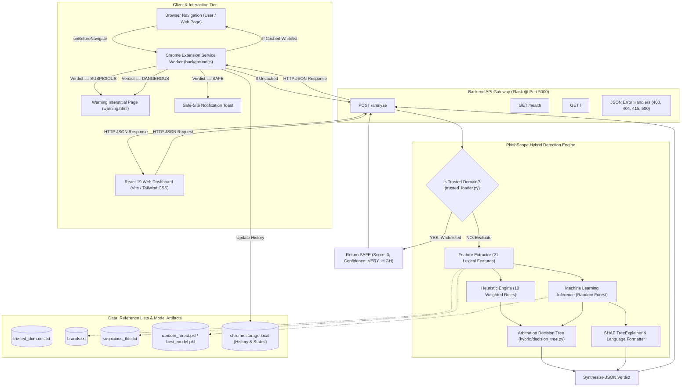
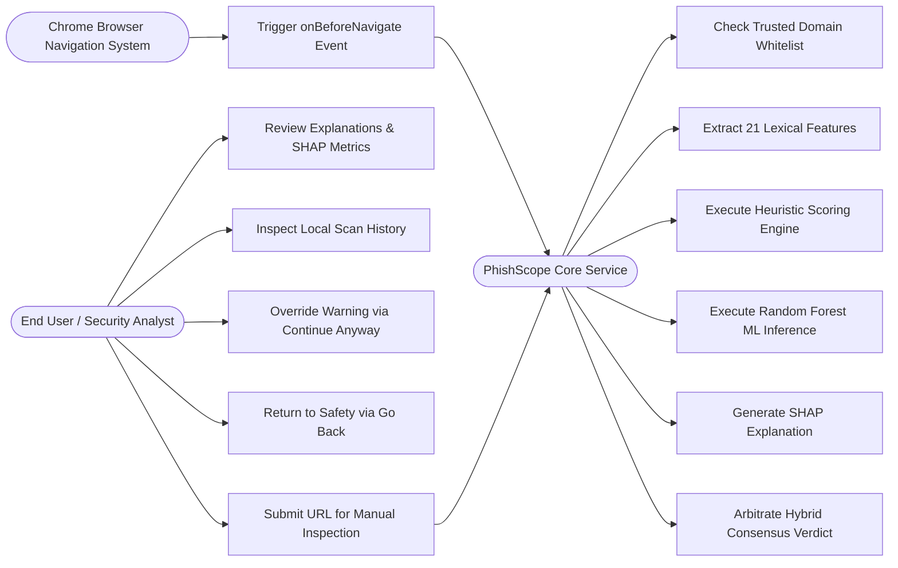
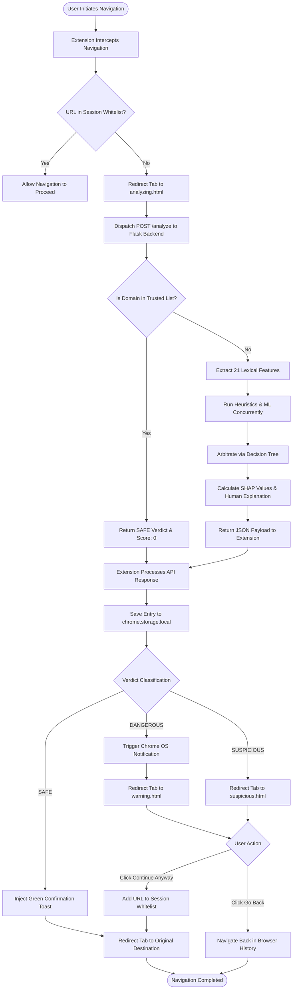
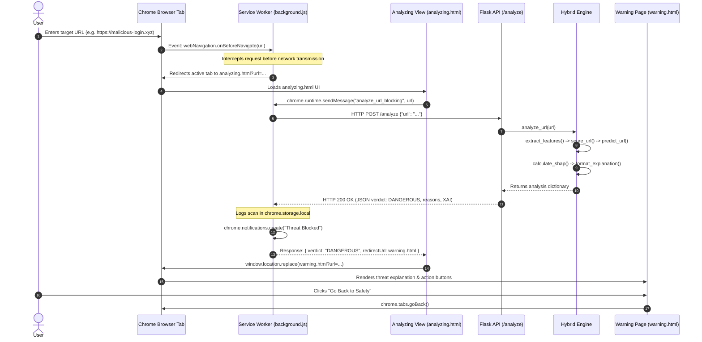
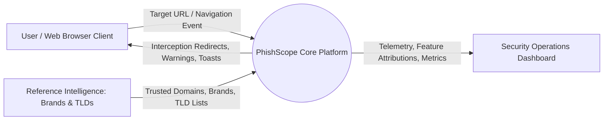
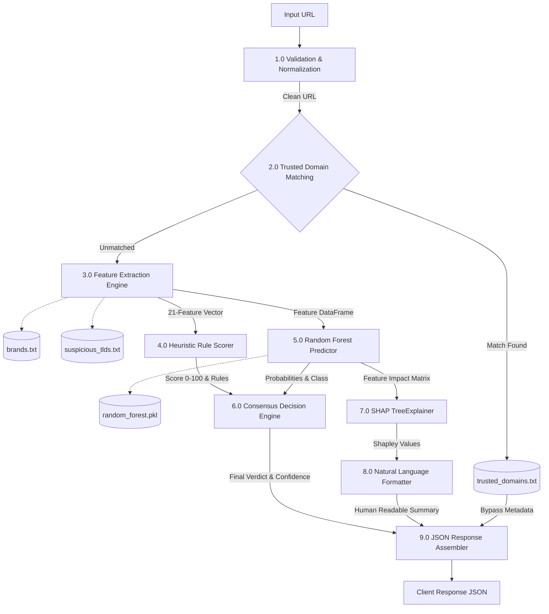
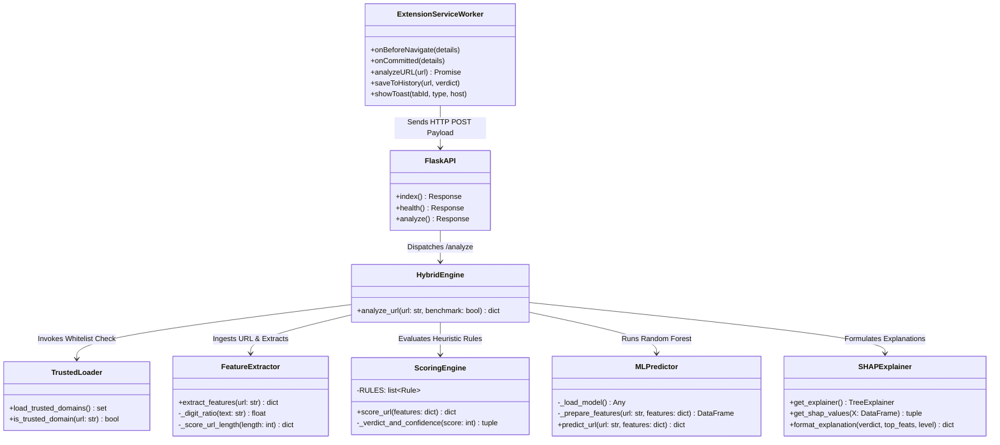

# PHISHSCOPE: INTELLIGENT HYBRID PHISHING DETECTION PLATFORM WITH EXPLAINABLE ARTIFICIAL INTELLIGENCE AND REAL-TIME BROWSER INTERCEPTION

---

### **A PROJECT REPORT**

*Submitted in partial fulfillment of the requirements for the award of the degree of*

#### **MASTER OF COMPUTER APPLICATIONS (MCA)**

---

**Submitted by:**  
**[STUDENT NAME - TO BE PROVIDED]**  
**(Register Number: [REGISTER NUMBER - TO BE PROVIDED])**  

*Under the Guidance of:*  
**[PROJECT GUIDE NAME - TO BE PROVIDED]**  
[Designation of Project Guide - TO BE PROVIDED]  

---

**DEPARTMENT OF COMPUTER APPLICATIONS**  
**[COLLEGE NAME - TO BE PROVIDED]**  
**[AFFILIATED UNIVERSITY NAME - TO BE PROVIDED]**  
**[ACADEMIC YEAR: 2025–2026 - TO BE PROVIDED]**  

---
\newpage

## CERTIFICATE

This is to certify that the project report entitled **"PhishScope: Intelligent Hybrid Phishing Detection Platform with Explainable Artificial Intelligence and Real-Time Browser Interception"** is a bonafide record of independent project work carried out by **[STUDENT NAME - TO BE PROVIDED]** (Register No.: **[REGISTER NUMBER - TO BE PROVIDED]**), in partial fulfillment of the requirements for the award of the degree of **Master of Computer Applications (MCA)** from **[AFFILIATED UNIVERSITY NAME - TO BE PROVIDED]** during the academic year **[ACADEMIC YEAR - TO BE PROVIDED]**.

\vspace{1.5cm}

----------------------------------------  
**[PROJECT GUIDE NAME - TO BE PROVIDED]**  
Internal Guide / Project Supervisor  
Department of Computer Applications  
[College Name - TO BE PROVIDED]  

\vspace{1.5cm}

----------------------------------------  
**[HEAD OF DEPARTMENT NAME - TO BE PROVIDED]**  
Head of the Department  
Department of Computer Applications  
[College Name - TO BE PROVIDED]  

\vspace{1.5cm}

**Viva-Voce Examination Conducted on:** \_\_\_\_\_\_\_\_\_\_\_\_\_\_\_\_\_\_\_\_  

**Internal Examiner:** \_\_\_\_\_\_\_\_\_\_\_\_\_\_\_\_\_\_\_\_\_\_\_  
**External Examiner:** \_\_\_\_\_\_\_\_\_\_\_\_\_\_\_\_\_\_\_\_\_\_\_  

---
\newpage

## DECLARATION

I, **[STUDENT NAME - TO BE PROVIDED]**, student of Master of Computer Applications (MCA) at **[COLLEGE NAME - TO BE PROVIDED]**, hereby declare that the project report entitled **"PhishScope: Intelligent Hybrid Phishing Detection Platform with Explainable Artificial Intelligence and Real-Time Browser Interception"** submitted to **[AFFILIATED UNIVERSITY NAME - TO BE PROVIDED]** is a record of original project work done by me under the supervision and guidance of **[PROJECT GUIDE NAME - TO BE PROVIDED]**, Department of Computer Applications, **[COLLEGE NAME - TO BE PROVIDED]**.

I further declare that this report has not been submitted previously in part or in full to any other university or institute for the award of any degree, diploma, associateship, fellowship, or any other similar title.

\vspace{1.5cm}

**Place:** [City - TO BE PROVIDED]  
**Date:** [Date - TO BE PROVIDED]  

\vspace{1cm}

----------------------------------------  
**[STUDENT NAME - TO BE PROVIDED]**  
Register Number: **[REGISTER NUMBER - TO BE PROVIDED]**  

---
\newpage

## ACKNOWLEDGEMENT

First and foremost, I express my profound gratitude to the Almighty for bestowing upon me the strength, perseverance, and knowledge necessary to bring this project to a successful completion.

I express my sincere thanks to **[PRINCIPAL NAME - TO BE PROVIDED]**, Principal, **[COLLEGE NAME - TO BE PROVIDED]**, for providing the institutional support and state-of-the-art laboratory infrastructure required for the completion of this research and software engineering endeavor.

I convey my deep sense of gratitude to **[HEAD OF DEPARTMENT NAME - TO BE PROVIDED]**, Head of the Department of Computer Applications, for continuous encouragement, valuable suggestions, and intellectual support throughout the course of the MCA program.

I am immensely indebted to my project supervisor, **[PROJECT GUIDE NAME - TO BE PROVIDED]**, [Designation], for insightful guidance, constructive critiques, technical suggestions, and patient mentoring during each phase of system analysis, architectural modeling, machine learning training, and client-side browser extension engineering.

I also extend my heartfelt appreciation to all faculty members, technical staff, and lab instructors of the Department of Computer Applications for their academic assistance and administrative cooperation.

Finally, I express my deepest love and heartfelt appreciation to my parents, family members, and peers whose moral support, encouragement, and understanding sustained my efforts throughout this academic pursuit.

\vspace{1cm}

----------------------------------------  
**[STUDENT NAME - TO BE PROVIDED]**  
Register Number: **[REGISTER NUMBER - TO BE PROVIDED]**  

---
\newpage

## ABSTRACT

Phishing attacks represent one of the most pervasive, evolving, and damaging cyber threats confronting Internet users and modern organizations. Traditional countermeasures rely heavily on centralized domain blacklists, DNS reputation databases, or monolithic machine learning classifiers. However, blacklist-based approaches exhibit critical latency—failing to intercept newly synthesized zero-hour phishing domains that frequently survive for less than four hours—while standalone machine learning models suffer from black-box uninterpretability and prone to false-positive classification on complex, high-entropy legitimate enterprise URLs.

To resolve these challenges, this project introduces **PhishScope**, an enterprise-grade, multi-tiered phishing detection and prevention platform engineered through a hybrid architecture that synthesizes heuristic rule scoring, supervised machine learning, explainable artificial intelligence (XAI), and zero-friction client-side browser navigation interception. 

PhishScope's analytical backend is developed in Python using Flask and implements a 21-dimensional lexical and structural feature extractor capable of computing Shannon entropy, Punycode/IDNA transformations, ASCII/Unicode homoglyph spoofing, TLD reputation indices, brand-mismatch positions, and suspicious keyword distributions. The machine learning pipeline utilizes a balanced corpus of 99,996 URLs extracted from PhishTank and top-ranking global web registries. Among comparative benchmarks evaluating Logistic Regression, Support Vector Machines (SVM), Decision Trees, and Random Forests, an ensemble Random Forest classifier achieved a peak accuracy of **98.55%**, precision of **98.99%**, recall of **98.09%**, and an ROC-AUC of **99.59%**.

To eradicate the black-box dilemma, PhishScope integrates **SHAP (SHapley Additive exPlanations)** to compute Shapley feature importance attributions for every real-time inference, mapped to a tri-tier human-readable natural language explanation engine (Basic, Advanced, and Technical). A consensus-based Hybrid Decision Tree arbitrates between heuristic scores and ML probabilities, backed by an in-memory trusted domain whitelist that prevents false alarms on high-traffic platforms (e.g., ChatGPT, GitHub, Google, YouTube). 

The platform exposes its capabilities through a RESTful API, a modern React 19 single-page analytical dashboard with Recharts visualizations, and a Google Chrome Manifest V3 browser extension. The extension implements synchronous navigation interception via `chrome.webNavigation`, transparently inspecting outgoing requests, suppressing malicious loads prior to HTTP transmission, displaying contextual security toasts for legitimate domains, and redirecting dangerous destinations to an explanatory interstitial warning interface. PhishScope provides a production-ready, performant (<40ms single-URL processing latency), and completely transparent defensive ecosystem against contemporary phishing threats.

---
\newpage

## TABLE OF CONTENTS

- [Certificate](#certificate)
- [Declaration](#declaration)
- [Acknowledgement](#acknowledgement)
- [Abstract](#abstract)
- [List of Figures](#list-of-figures)
- [List of Tables](#list-of-tables)
- [Chapter 1 — Introduction](#chapter-1--introduction)
  - [1.1 Introduction](#11-introduction)
  - [1.2 Background](#12-background)
  - [1.3 Problem Statement](#13-problem-statement)
  - [1.4 Motivation](#14-motivation)
  - [1.5 Objectives of the Project](#15-objectives-of-the-project)
  - [1.6 Scope of the Project](#16-scope-of-the-project)
  - [1.7 Significance of the Project](#17-significance-of-the-project)
  - [1.8 Overview of PhishScope](#18-overview-of-phishscope)
  - [1.9 Organization of the Report](#19-organization-of-the-report)
- [Chapter 2 — Literature Review](#chapter-2--literature-review)
  - [2.1 The Evolution of Phishing Attacks](#21-the-evolution-of-phishing-attacks)
  - [2.2 URL-Based Phishing Detection Methodologies](#22-url-based-phishing-detection-methodologies)
  - [2.3 Machine Learning and Heuristic Approaches](#23-machine-learning-and-heuristic-approaches)
  - [2.4 Explainable AI (XAI) in Cybersecurity](#24-explainable-ai-xai-in-cybersecurity)
  - [2.5 Browser-Integrated Navigation Security](#25-browser-integrated-navigation-security)
  - [2.6 Comparative Analysis of Existing Literature](#26-comparative-analysis-of-existing-literature)
- [Chapter 3 — Existing System](#chapter-3--existing-system)
  - [3.1 Overview of Current Phishing Defenses](#31-overview-of-current-phishing-defenses)
  - [3.2 Existing Technologies and Mechanisms](#32-existing-technologies-and-mechanisms)
  - [3.3 Limitations and Vulnerabilities](#33-limitations-and-vulnerabilities)
  - [3.4 Need for the Proposed System](#34-need-for-the-proposed-system)
- [Chapter 4 — Proposed System](#chapter-4--proposed-system)
  - [4.1 Architecture and Concept](#41-architecture-and-concept)
  - [4.2 Objectives and Goals](#42-objectives-and-goals)
  - [4.3 Major Features and Capabilities](#43-major-features-and-capabilities)
  - [4.4 System Architecture](#44-system-architecture)
  - [4.5 System Components](#45-system-components)
  - [4.6 Functional Requirements](#46-functional-requirements)
  - [4.7 Non-Functional Requirements](#47-non-functional-requirements)
  - [4.8 Hardware Requirements](#48-hardware-requirements)
  - [4.9 Software Requirements](#49-software-requirements)
  - [4.10 Technology Stack Summary](#410-technology-stack-summary)
  - [4.11 Key Advantages of the Proposed Architecture](#411-key-advantages-of-the-proposed-architecture)
- [Chapter 5 — System Analysis and Design](#chapter-5--system-analysis-and-design)
  - [5.1 High-Level Architectural Design](#51-high-level-architectural-design)
  - [5.2 Module Design and Partitioning](#52-module-design-and-partitioning)
  - [5.3 Comprehensive Module Descriptions](#53-comprehensive-module-descriptions)
  - [5.4 Data Flow and Lifecycle](#54-data-flow-and-lifecycle)
  - [5.5 Use Case Modeling](#55-use-case-modeling)
  - [5.6 Activity Modeling](#56-activity-modeling)
  - [5.7 Sequence Modeling](#57-sequence-modeling)
  - [5.8 Data Flow Diagrams (Context & Level 1)](#58-data-flow-diagrams-context--level-1)
  - [5.9 Data Storage & Persistence Architecture](#59-data-storage--persistence-architecture)
  - [5.10 Class and Component Structure](#510-class-and-component-structure)
  - [5.11 Deployment Architecture](#511-deployment-architecture)
  - [5.12 RESTful API Design Specification](#512-restful-api-design-specification)
  - [5.13 Security Design and Threat Mitigation](#513-security-design-and-threat-mitigation)
- [Chapter 6 — System Implementation](#chapter-6--system-implementation)
  - [6.1 Lexical and Structural Feature Extractor Implementation](#61-lexical-and-structural-feature-extractor-implementation)
  - [6.2 Rule-Based Heuristic Scoring Engine Implementation](#62-rule-based-heuristic-scoring-engine-implementation)
  - [6.3 Hybrid Consensus Decision Engine Implementation](#63-hybrid-consensus-decision-engine-implementation)
  - [6.4 Explainable AI (SHAP) & Natural Language Explainer](#64-explainable-ai-shap--natural-language-explainer)
  - [6.5 Backend REST API Engine Implementation](#65-backend-rest-api-engine-implementation)
  - [6.6 Modern Single-Page Application (SPA) Frontend Implementation](#66-modern-single-page-application-spa-frontend-implementation)
  - [6.7 Chrome Manifest V3 Browser Extension Implementation](#67-chrome-manifest-v3-browser-extension-implementation)
  - [6.8 False Positive Mitigation System](#68-false-positive-mitigation-system)
  - [6.9 Error Handling and Logging Implementation](#69-error-handling-and-logging-implementation)
- [Chapter 7 — Machine Learning / AI Methodology](#chapter-7--machine-learning--ai-methodology)
  - [7.1 Machine Learning Pipeline Overview](#71-machine-learning-pipeline-overview)
  - [7.2 Dataset Curation, Ingestion, and Cleaning](#72-dataset-curation-ingestion-and-cleaning)
  - [7.3 Feature Engineering and Transformation](#73-feature-engineering-and-transformation)
  - [7.4 Feature Importance Attribution](#74-feature-importance-attribution)
  - [7.5 Model Selection Benchmarking](#75-model-selection-benchmarking)
  - [7.6 Model Training and Serialization](#76-model-training-and-serialization)
  - [7.7 Model Evaluation and Performance Metrics](#77-model-evaluation-and-performance-metrics)
  - [7.8 Real-Time Inference and Model Integration](#78-real-time-inference-and-model-integration)
- [Chapter 8 — System Testing and Quality Assurance](#chapter-8--system-testing-and-quality-assurance)
  - [8.1 Testing Strategy and Verification Matrix](#81-testing-strategy-and-verification-matrix)
  - [8.2 Automated Unit Testing](#82-automated-unit-testing)
  - [8.3 Integration and Pipeline Testing](#83-integration-and-pipeline-testing)
  - [8.4 API Verification and Error Resilience Testing](#84-api-verification-and-error-resilience-testing)
  - [8.5 Browser Extension Functional Testing](#85-browser-extension-functional-testing)
  - [8.6 Master Test Cases and Results](#86-master-test-cases-and-results)
- [Chapter 9 — Results and Performance Analysis](#chapter-9--results-and-performance-analysis)
  - [9.1 Experimental Results Overview](#91-experimental-results-overview)
  - [9.2 Machine Learning Performance Analysis](#92-machine-learning-performance-analysis)
  - [9.3 Hybrid Consensus Engine Accuracy Benchmark](#93-hybrid-consensus-engine-accuracy-benchmark)
  - [9.4 False Positive Reduction and Optimization Results](#94-false-positive-reduction-and-optimization-results)
  - [9.5 Computational Efficiency and Latency Benchmarks](#95-computational-efficiency-and-latency-benchmarks)
  - [9.6 User Interface and User Experience Assessment](#96-user-interface-and-user-experience-assessment)
- [Chapter 10 — Advantages, Limitations, and Future Scope](#chapter-10--advantages-limitations-and-future-scope)
  - [10.1 Advantages of PhishScope](#101-advantages-of-phishscope)
  - [10.2 Limitations of the Current Implementation](#102-limitations-of-the-current-implementation)
  - [10.3 Technical Challenges Encountered](#103-technical-challenges-encountered)
  - [10.4 Future Research and Development Directions](#104-future-research-and-development-directions)
- [Chapter 11 — Conclusion](#chapter-11--conclusion)
- [References](#references)
- [Appendices](#appendices)
  - [Appendix A: Project Directory Tree & File Inventory](#appendix-a-project-directory-tree--file-inventory)
  - [Appendix B: RESTful API Endpoint Schemas](#appendix-b-restful-api-endpoint-schemas)
  - [Appendix C: Feature Dictionary & Risk Weights](#appendix-c-feature-dictionary--risk-weights)
  - [Appendix D: Visual Artifacts & Screenshot Specifications](#appendix-d-visual-artifacts--screenshot-specifications)
  - [Appendix E: Installation, Setup, and Execution Manual](#appendix-e-installation-setup-and-execution-manual)

---
\newpage

## LIST OF FIGURES

1. **Figure 4.1**: PhishScope Multi-Tiered System Architecture Diagram
2. **Figure 5.1**: Use Case Diagram for PhishScope Security System
3. **Figure 5.2**: Activity Diagram: End-to-End URL Interception and Analysis Workflow
4. **Figure 5.3**: Sequence Diagram: Browser Navigation Interception, API Inspection, and Interstitial Warning
5. **Figure 5.4**: Context-Level Data Flow Diagram (DFD Level 0)
6. **Figure 5.5**: Level 1 Data Flow Diagram (DFD Level 1: Feature Extraction, Scoring, and XAI)
7. **Figure 5.6**: Component Interaction and Structural Package Diagram
8. **Figure 5.7**: Physical Deployment Architecture Topology
9. **Figure 7.1**: Receiver Operating Characteristic (ROC) Curve of the Random Forest Classifier
10. **Figure 7.2**: Confusion Matrix of Model Predictions on the 20,000 URL Evaluation Split
11. **Figure 7.3**: Top 10 Feature Importance Distribution (Scikit-Learn Gini Impurity)
12. **Figure 7.4**: SHAP Local Waterfall Attribution Representation
13. **Figure 9.1**: [INSERT SCREENSHOT: PhishScope React Web Dashboard & Real-Time Analyzer Interface]
14. **Figure 9.2**: [INSERT SCREENSHOT: Chrome Extension Navigation Interception and Warning Interstitial Page]

---
\newpage

## LIST OF TABLES

1. **Table 2.1**: Comparative Matrix of Related Phishing Detection Literature
2. **Table 4.1**: Functional Requirements Specification (FRS)
3. **Table 4.2**: Hardware Specifications
4. **Table 4.3**: Software Specifications
5. **Table 4.4**: Master Technology Stack Breakdown
6. **Table 5.1**: Backend REST API Specifications
7. **Table 5.2**: Client-Side Storage Schema (`chrome.storage.local`)
8. **Table 6.1**: Heuristic Engine Scoring Rules and Risk Point Allocations
9. **Table 7.1**: Data Cleaning and Balancing Pipeline Statistics
10. **Table 7.2**: Complete Ranked Feature Importance Distribution
11. **Table 7.3**: Machine Learning Model Benchmark Comparison (Train Split Accuracy)
12. **Table 7.4**: Performance Evaluation Metrics of the Random Forest Classifier (20,000 URL Test Set)
13. **Table 7.5**: Precision, Recall, and F1-Score Breakdown by Classification Class
14. **Table 8.1**: Automated Unit and Integration Test Distribution by Phase
15. **Table 8.2**: Master System and Functional Test Cases Execution Log
16. **Table 9.1**: Engine Accuracy Comparison (Heuristic vs. Random Forest vs. Hybrid Consensus)
17. **Table 9.2**: Execution Latency and Benchmarking Statistics

---
\newpage

# CHAPTER 1 — INTRODUCTION

## 1.1 Introduction
The rapid expansion of global internet connectivity and cloud computing has established web browsers as the universal interface for commerce, banking, communications, and social interactions. Concurrently, social engineering attacks—predominantly phishing—have evolved into one of the most dangerous and destructive threat vectors in contemporary cybersecurity. Phishing is a fraudulent attempt to masquerade as a trustworthy entity to deceive end users into surrendering sensitive credentials, personal identifying information, financial tokens, or cryptographic secrets.

Attackers deploy hyper-realistic phishing landing pages supported by homoglyph character substitutions, obfuscated domain structures, temporary cloud hosting, and dynamic URL shortening. Traditional static defenses, such as domain blocklists and URL blacklists, operate reactively. Because adversary campaigns frequently generate short-lived, polymorphic URLs that exist for under four hours, signature-driven blacklists leave an alarming window of vulnerability known as zero-hour phishing.

**PhishScope** is an advanced cybersecurity platform engineered to address this crisis through intelligent, explainable, and multi-layered web protection. By synthesizing rule-based heuristic analysis, machine learning classification, explainable artificial intelligence (XAI), and zero-click browser navigation interception, PhishScope provides proactive, real-time protection against malicious web destinations.

## 1.2 Background
Historically, phishing detection relied on centralized blacklists such as Google Safe Browsing and PhishTank. When a user navigates to a web page, the client queries local or remote hashes of known malicious domains. While effective for established threats, these registries depend upon human reporting and delayed verification cycles. 

To overcome this latency, researchers introduced machine-learning models trained on lexical URL properties and web page document object model (DOM) structures. However, DOM-based analysis requires downloading and parsing HTML/JavaScript assets, introducing substantial latency and exposing users to drive-by malware payloads. In contrast, pure lexical URL analysis evaluates the uniform resource locator itself before an HTTP connection is established.

Despite the benefits of lexical machine learning, black-box classification algorithms frequently fail to provide security auditors and end users with actionable justifications for their verdicts. When a model incorrectly labels an enterprise domain as malicious (a false positive), users lack the technical clarity needed to resolve the blockage. PhishScope bridges this divide by uniting high-precision machine learning with the mathematical interpretability of Shapley values and rule-based heuristics.

## 1.3 Problem Statement
Modern phishing attacks exploit the structural and perceptual limitations of domain naming systems and human cognitive patterns. Current detection architectures suffer from four primary vulnerabilities:
1. **Detection Latency:** Signature-based blacklists fail against zero-hour domains created on demand.
2. **The Black-Box Dilemma:** Deep learning and complex ensemble models yield binary outputs without transparency, eroding user trust and impeding post-incident analysis.
3. **The False Positive Paradox on Complex Benign URLs:** Advanced web applications (such as collaboration portals, cloud tools, and developer platforms) routinely utilize long, high-entropy URLs with multiple subdomains that trigger naive heuristic or statistical alarms.
4. **Passive User Dependence:** Many defensive extensions require users to manually click an icon or initiate a scan after navigation has commenced, exposing the browser to malicious payloads.

Hence, there is an acute need for an autonomous, explainable, low-latency phishing detection system capable of intercepting web requests before HTTP execution, verifying them against trusted domain baselines, classifying them through hybrid consensus, and presenting plain-language rationales.

## 1.4 Motivation
The primary motivation behind PhishScope is to empower everyday internet users and cybersecurity operations teams with an transparent, highly accurate, and always-on security guard. Rather than forcing users to choose between the speed of heuristics, the statistical power of ensemble learning, or the interpretability of expert systems, PhishScope demonstrates that all three paradigms can be harmonized into a single cohesive architecture. 

Furthermore, the implementation of Google Chrome's Manifest V3 standard introduces strict runtime constraints for browser extensions, prohibiting remotely hosted scripts and enforcing declarative service workers. Designing a fully compliant Manifest V3 client that conducts seamless navigation interception while offloading computation to a dedicated local REST microservice represents a timely and academically challenging software engineering project.

## 1.5 Objectives of the Project
The core technical and research objectives of the PhishScope project are:
1. **High-Fidelity Feature Extraction:** To engineer a 21-dimensional lexical and structural feature extraction engine in Python capable of computing Shannon entropy, Punycode/IDNA transformations, ASCII/Unicode homoglyphs, brand mismatch metrics, and TLD threat scores in under 5 milliseconds.
2. **Corpus Construction and Pipeline Automation:** To ingest, clean, balance, and split a large-scale real-world dataset comprising over 115,000 raw URLs sourced from PhishTank and global legitimate registries.
3. **Supervised Machine Learning Optimization:** To benchmark, train, and serialize an ensemble machine learning classifier that achieves greater than 98% accuracy and precision on unseen testing corpora.
4. **Explainable AI Integration:** To implement SHAP (SHapley Additive exPlanations) atop tree-based models and design an interpreter that maps numeric Shapley values into tri-tier human-readable explanations.
5. **Hybrid Consensus Architecture:** To develop an arbitration decision tree that harmonizes heuristic risk scores (0–100) with ML class probabilities, eliminating false alarms via an in-memory trusted domain baseline.
6. **Real-Time Client Interception:** To implement a Chrome Manifest V3 browser extension that transparently intercepts navigation before HTTP execution, redirects threats to an informative interstitial warning, and informs users with non-intrusive safety toasts.
7. **Full-Stack Analytical Interface:** To deliver a React 19 web application providing interactive URL auditing, dynamic risk meters, and Recharts-based visual dashboards.

## 1.6 Scope of the Project
The current scope of PhishScope encompasses:
- Lexical, structural, and character-level analysis of URL strings across IPv4, IPv6, Punycode, and internationalized domain names (IDN).
- Detection of brand spoofing, brand squatting, and typosquatting targeting major global enterprises.
- Offline-trained supervised classification serialized via Joblib, loaded into an active Flask microservice for high-throughput batch or single-item inference.
- Synchronous navigation interception within Chromium-based web browsers (Google Chrome, Microsoft Edge, Brave) via Manifest V3 service workers.
- Evaluation across a static benchmark test set of 20,000 URLs.

*Delimitations:* The current system focuses purely on pre-navigation lexical and structural URL analysis. It does not download or execute remote web page assets, analyze rendered DOM trees, execute active sandboxing, or record network packet captures.

## 1.7 Significance of the Project
PhishScope contributes directly to academic cybersecurity research and applied software engineering by providing:
- **Zero-Exposure Interception:** By intercepting navigations at the `webNavigation.onBeforeNavigate` stage and replacing the request with an internal extension interstitial page, PhishScope prevents browser connections to malicious IP addresses, shielding users from drive-by downloads and browser exploit kits.
- **Explainability as a Security Feature:** Moving beyond opaque risk scores, PhishScope articulates exactly *why* a domain is dangerous (e.g., mismatched brand keywords, high character randomness, or suspicious TLDs).
- **Practical False Positive Reduction:** By leveraging a domain verification layer, PhishScope eliminates the friction common to security tools that erroneously block complex SaaS workflows.

## 1.8 Overview of PhishScope
PhishScope is organized into distinct, modular functional tiers:
1. **Core Feature Extraction Layer (`backend.analyzer`):** Parses raw URLs, isolates hostname components via `tldextract`, and calculates 21 numerical, boolean, and categorical features.
2. **Heuristic Scoring Engine (`backend.analyzer.scoring_engine`):** Evaluates URLs against 10 weighted security rules, returning a score from 0 to 100, confidence levels, and human-readable trigger justifications.
3. **Machine Learning Layer (`ml`):** Houses the dataset preparation pipeline, model training scripts, evaluation metrics, and a pre-trained Random Forest classifier.
4. **Explainable AI Layer (`xai`):** Computes TreeExplainer SHAP values and converts them into Basic, Advanced, and Technical text summaries.
5. **Hybrid Consensus Engine (`hybrid`):** Combines heuristic verdicts and ML predictions through an override decision tree and trusted domain whitelist.
6. **RESTful API Service (`backend.app`):** Exposes high-speed HTTP JSON endpoints (`GET /`, `GET /health`, `POST /analyze`) built on Flask.
7. **Client Web Application (`frontend`):** A modern React 19 single-page application built with Vite and Tailwind CSS.
8. **Browser Security Extension (`extension`):** An always-on Chrome Manifest V3 service worker providing proactive navigation interception, system notifications, and safe-site toast feedback.

## 1.9 Organization of the Report
This report is structured into eleven distinct chapters:
- **Chapter 1** presents the introduction, background, problem statement, objectives, and scope.
- **Chapter 2** reviews relevant academic literature in phishing detection, ML techniques, and explainable AI.
- **Chapter 3** analyzes existing anti-phishing systems, tools, and their structural limitations.
- **Chapter 4** outlines the proposed PhishScope architecture, requirements, and hardware/software specifications.
- **Chapter 5** provides in-depth system analysis and design models, including UML diagrams, DFDs, and API schemas.
- **Chapter 6** details the technical implementation of each software component with code references.
- **Chapter 7** explores the complete Machine Learning methodology, dataset pipeline, feature importances, and evaluation metrics.
- **Chapter 8** documents the testing strategy, unit tests, integration suites, and manual verification logs.
- **Chapter 9** presents experimental results, performance comparisons, latencies, and user interface assessments.
- **Chapter 10** reviews advantages, limitations, engineering hurdles, and avenues for future enhancement.
- **Chapter 11** concludes the report with a synthesis of project contributions.
- **References & Appendices** provide academic citations, complete API schemas, and technical setup guides.

---
\newpage

# CHAPTER 2 — LITERATURE REVIEW

## 2.1 The Evolution of Phishing Attacks
Phishing attacks have transitioned from mass-spam emails containing crude text lures into highly targeted, evasive spear-phishing campaigns. Modern cybercriminals leverage automated infrastructure to register domain names across hundreds of inexpensive generic top-level domains (gTLDs), such as `.click`, `.xyz`, and `.sbs`. Attackers frequently use character spoofing techniques including:
- **Homoglyph / Punycode Attacks:** Registering internationalized domain names (IDN) using Cyrillic or Greek characters that appear visually identical to Latin characters (e.g., substituting Latin 'a' with Cyrillic 'а', encoded as `xn--...`).
- **Combosquatting and Typosquatting:** Appending security-related tokens to legitimate brand names (e.g., `paypal-update-security.com`).
- **Subdomain Obfuscation:** Embedding reputable brand names within deep subdomains while routing traffic to an unrelated root domain (e.g., `paypal.com.account-verify.online`).

## 2.2 URL-Based Phishing Detection Methodologies
Scholars classify phishing detection mechanisms into two overarching categories: content-based and URL-based.

Content-based methodologies inspect the rendered HTML, CSS stylesheets, JavaScript logic, and imagery of the target web page. While effective at recognizing cloned login forms, content-based inspection imposes significant computational overhead and requires fetching the malicious payload, exposing the client to zero-day browser vulnerabilities.

URL-based detection treats the URL string as an isolated artifact. Pioneering research by Ma et al. demonstrated that lexical and host-based properties of URLs possess distinct statistical profiles that differentiate malicious domains from benign sites without requiring page downloads. URL-based detection is computationally efficient, privacy-preserving, and enables pre-navigation interception.

## 2.3 Machine Learning and Heuristic Approaches
A wide spectrum of classification models has been explored in literature:
- **Heuristic Rule-Based Engines:** Heuristic systems rely on expert-crafted signatures, such as the presence of IP addresses in hostnames, excessive hyphens, or blacklisted TLDs. While heuristics execute with minimal latency and offer high explainability, they are brittle when confronting novel obfuscation patterns.
- **Support Vector Machines (SVM) and Logistic Regression:** Linear and kernel classifiers have demonstrated strong predictive capabilities for high-dimensional feature spaces, but their inference times can degrade on non-linear datasets.
- **Decision Trees and Random Forests:** Ensemble tree models, particularly Random Forests, consistently outperform single classifiers in phishing detection due to their resilience to overfitting, ability to capture non-linear feature interactions, and insensitivity to monotonic feature scaling.

## 2.4 Explainable AI (XAI) in Cybersecurity
Despite the success of machine learning, modern models often operate as opaque "black boxes." In critical domains like cybersecurity, users and security operations center (SOC) analysts reject unexplainable classifications. 

Lundberg and Lee proposed **SHAP (SHapley Additive exPlanations)**, an axiomatic game-theoretic approach that computes the additive contribution of each feature to a model's prediction. By utilizing `TreeExplainer` algorithms, local explanations can be generated in polynomial time for tree ensemble models. Incorporating SHAP into phishing detection provides users with precise insight into the lexical properties driving a malicious classification.

## 2.5 Browser-Integrated Navigation Security
The implementation of browser security extensions has historically relied on Google Chrome Manifest V2. However, Manifest V2 permitted persistent background pages, creating memory overhead and security vulnerabilities. Under **Manifest V3**, persistent background scripts are replaced by ephemeral service workers. Browser extensions must execute navigation filtering through event-driven APIs such as `chrome.webNavigation` and `chrome.declarativeNetRequest`. Engineering client-side security tools under Manifest V3 requires asynchronous message passing, lightweight storage mechanisms, and optimized API roundtrips.

## 2.6 Comparative Analysis of Existing Literature

The following table synthesizes relevant research literature and anti-phishing systems, highlighting their methodologies, advantages, and limitations in comparison to PhishScope.

| Research Study / System | Methodology Employed | Key Advantages | Primary Limitations |
| :--- | :--- | :--- | :--- |
| **Google Safe Browsing (2007–Present)** | Centralized hash-based blacklisting and URL verification feeds. | Extremely high precision; zero false positives on known sites. | Reactive; fails against zero-hour domains; high update propagation delay. |
| **Ma et al. (2009)** | Lexical and host-based URL feature classification via linear models. | Pre-navigation capability; does not require downloading page assets. | Outdated feature sets; lacks explainability; high false positives on modern CDN URLs. |
| **Marchal et al. (2014) - Off-the-Hook** | Client-side Bayesian heuristics inspecting brand and lexical patterns. | Preserves user privacy; operates directly on client endpoints. | Hand-crafted rules degrade quickly as attackers adjust domain naming habits. |
| **Sahingoz et al. (2019)** | Machine learning with Natural Language Processing (NLP) feature vectors. | High accuracy across diverse gTLDs using Random Forests. | Computationally intensive; black-box predictions; no browser interception client. |
| **PhishScope (This Work)** | **Hybrid Consensus: Random Forest (21 features) + Heuristics + SHAP XAI + Trusted Whitelist + Manifest V3 Interception.** | **Proactive pre-navigation blocking; 98.55% accuracy; real-time SHAP explainability; false-positive mitigation.** | **Requires local backend microservice; does not inspect internal rendered DOM assets.** |

---
\newpage

# CHAPTER 3 — EXISTING SYSTEM

## 3.1 Overview of Current Phishing Defenses
Contemporary end-user protection against phishing relies on three defensive perimeters:
1. **Network-Level DNS Firewalls:** Enterprise DNS resolvers (e.g., Cisco Umbrella, Cloudflare 1.1.1.2) inspect DNS lookup requests and block domains flagged by threat intelligence feeds.
2. **Centralized Browser Blacklists:** Commercial browsers embed client implementations of Google Safe Browsing or Microsoft SmartScreen.
3. **Endpoint Email Filters:** Secure Email Gateways (SEGs) scan inbound emails for known malicious links and rewrite URLs through scanning proxies.

## 3.2 Existing Technologies and Mechanisms
- **Signature and Blacklist Feeds:** Systems continuously ingest feeds from repositories such as PhishTank, OpenPhish, and the Anti-Phishing Working Group (APWG). When an endpoint navigates to a URL, the URL prefix or its SHA-256 hash is compared against the local bloom filter or remote database.
- **Deep Neural Networks (DNN):** Modern corporate gateways deploy deep learning architectures (e.g., CNN-LSTMs) that process raw URL character strings through embedding layers to compute a threat likelihood.

## 3.3 Limitations and Vulnerabilities
Despite these defenses, credential theft remains at record highs due to systemic architectural flaws in existing tools:
1. **The Zero-Hour Vulnerability Window:** Studies indicate that the median lifespan of a phishing domain is under four hours. Because human analysts or automated crawlers must first discover and verify a malicious link, blacklists exhibit an average latency of 12 to 24 hours. Consequently, the earliest and most vulnerable victims are unprotected.
2. **Severe False-Positive Disruption:** Enterprise SaaS tools generate complex URLs featuring high entropy strings, GUIDs, and deep subdomain nesting. Static heuristic engines flag these patterns indiscriminately, disrupting enterprise operations.
3. **Black-Box Opacity and User Disregard:** When a browser blocks a site with a generic warning like *"This site is dangerous"*, users frequently bypass the warning due to lack of technical justification or contextual evidence.
4. **Passive and Intrusive Architectures:** Extensions that require manual user clicking before analyzing a link fail to protect passive users. Conversely, tools that inspect page content introduce heavy network and rendering latency.

## 3.4 Need for the Proposed System
To overcome these limitations, an anti-phishing platform must satisfy four non-negotiable criteria:
- **Zero-Click, Pre-Navigation Protection:** Protection must occur automatically before network packets reach the suspect destination.
- **Intelligent Hybrid Consensus:** A balanced architecture that leverages machine learning for general pattern recognition, reinforced by deterministic heuristics for known attack vectors, and governed by a trusted-domain filter.
- **Axiomatic Explainability:** Classifications must be accompanied by intuitive, human-understandable justifications detailing the specific features triggering the alert.
- **Low-Latency Execution:** The entire analysis pipeline must execute in tens of milliseconds to ensure imperceptible browser performance impact.

PhishScope was conceived, designed, and implemented to fulfill these precise requirements.

---
\newpage

# CHAPTER 4 — PROPOSED SYSTEM

## 4.1 Architecture and Concept
PhishScope is a full-stack, AI-powered phishing detection and prevention ecosystem designed to provide seamless protection for web browsers. The platform does not rely on a single defensive mechanism. Instead, it deploys a **defense-in-depth hybrid consensus model** that synergizes:
1. Lexical and character-level feature extraction.
2. Deterministic rule-based heuristic scoring.
3. Supervised ensemble classification (Random Forest).
4. Local feature attribution via SHAP TreeExplainer.
5. In-memory trusted domain validation.
6. Ephemeral client-side browser navigation interception.

By decoupling computationally intensive machine learning and XAI analysis into an asynchronous Python Flask microservice, PhishScope maintains a lightweight footprint within the browser, ensuring real-time response times.

## 4.2 Objectives and Goals
- Ingest raw URLs and return a comprehensive security verdict within **40 milliseconds**.
- Achieve greater than **98% classification accuracy** on large-scale real-world datasets.
- Reduce false positive rates on complex, high-entropy enterprise web applications to near zero.
- Present plain-language explanations of security risks tailored to three user expertise levels.
- Deliver an always-on, zero-friction Manifest V3 Chrome extension that autonomously blocks malicious navigation attempts.

## 4.3 Major Features and Capabilities
- **Pre-Navigation Interception:** Intercepts outgoing HTTP requests at the browser service worker level, preventing communication with dangerous servers.
- **21-Dimensional Feature Analysis:** Evaluates structural metrics (length, dot counts, hyphen counts, subdomains), mathematical metrics (Shannon entropy, digit ratios), threat metrics (TLD risk indices), and semantic patterns (brand mismatch, Punycode, homoglyphs).
- **Consensus-Driven Verdicts:** Combines heuristic scores (0–100) and ML confidence scores (0.0–1.0) into three standardized risk verdicts: **SAFE**, **SUSPICIOUS**, and **DANGEROUS**.
- **Interactive Interstitial Warnings:** Redirects users away from confirmed threats to an internal warning page providing full risk breakdowns, an immediate "Go Back to Safety" action, and an override "Continue Anyway" path.
- **Safe-Site Toast Confirmation:** Injects temporary, non-disruptive confirmation toasts when users visit recognized trusted platforms.
- **Multi-Level Explainable AI (SHAP):** Translates complex mathematical Shapley values into clear, natural language statements explaining which URL features influenced the verdict.
- **Analytical Web Dashboard:** Provides an interface for manual URL testing, feature inspection, and statistical visualization.

## 4.4 System Architecture
The high-level architecture of PhishScope is illustrated in Figure 4.1.


*Figure 4.1: PhishScope Multi-Tiered System Architecture Diagram.*

## 4.5 System Components
1. **Browser Extension Client:** An always-on Chrome extension operating under Manifest V3 specifications. It intercepts navigation events, communicates with the API, manages client-side storage, and renders user warning pages.
2. **API Microservice:** A Python-based Flask service exposing REST endpoints, managing CORS headers, validating JSON payloads, and coordinating inference pipelines.
3. **Feature Extraction Module:** An algorithmic parser converting raw URLs into normalized lexical feature vectors.
4. **Heuristic Rule Engine:** A deterministic security evaluator that scores URLs against established threat signatures.
5. **Machine Learning Pipeline:** An offline model trainer, validator, and real-time predictor powered by Scikit-Learn.
6. **Explainable AI Module:** An interpretation engine powered by the SHAP library that attributes feature impacts and maps them to human-readable explanations.
7. **Consensus Arbitration Layer:** A decision engine resolving discrepancies between heuristic rules and machine learning predictions.
8. **Web Management Dashboard:** A React 19 single-page application enabling standalone URL testing and analytical visualization.

## 4.6 Functional Requirements
The functional requirements of PhishScope are detailed in Table 4.1.

| Requirement ID | Requirement Title | Detailed Description |
| :--- | :--- | :--- |
| **FR-01** | URL Ingestion & Normalization | The system must accept raw URLs, validate their format, prepend default protocols if missing, and normalize components. |
| **FR-02** | Lexical Feature Extraction | The system must compute 21 distinct structural, character, and contextual features for any valid URL within 10 ms. |
| **FR-03** | Trusted Domain Bypass | The system must check incoming domains against an internal whitelist and return an immediate SAFE verdict for trusted sites. |
| **FR-04** | Heuristic Risk Scoring | The system must evaluate extracted features against 10 weighted rules and compute a bounded score between 0 and 100. |
| **FR-05** | ML Model Inference | The system must generate a probabilistic prediction (PHISHING or SAFE) using a pre-trained Random Forest model. |
| **FR-06** | XAI Feature Attribution | The system must compute local SHAP values for each inference, identifying the top features driving the classification. |
| **FR-07** | Tri-Tier Human Explanations | The system must map technical feature impacts into Basic, Advanced, and Technical natural language descriptions. |
| **FR-08** | Hybrid Consensus Arbitration | The system must combine heuristic scores and ML probabilities to produce a final verdict: SAFE, SUSPICIOUS, or DANGEROUS. |
| **FR-09** | RESTful JSON API | The backend must expose `/analyze`, `/health`, and `/` endpoints, accepting and returning standard JSON payloads. |
| **FR-10** | Zero-Click Browser Interception| The Chrome extension must intercept top-level navigations before page loading and pause execution pending security checks. |
| **FR-11** | Interstitial Warning Interface | The extension must redirect dangerous or suspicious navigations to an internal warning page detailing the specific threat. |
| **FR-12** | Whitelist & Override Handling | Users must be able to bypass warnings via a "Continue Anyway" action, temporarily whitelisting the URL in memory. |
| **FR-13** | Local Scan History | The extension must store the 50 most recent URL scans and verdicts in `chrome.storage.local` for user review. |

*Table 4.1: Functional Requirements Specification (FRS).*

## 4.7 Non-Functional Requirements
- **Performance & Latency:** Total backend analysis latency must not exceed 50 ms for single-URL requests. The browser extension must introduce less than 100 ms of overhead to initial page navigations.
- **Reliability & Availability:** The backend must remain operational despite malformed inputs, returning standardized HTTP 400 or 415 responses without crashing.
- **Security & Privacy:** The extension must evaluate URLs in-flight without recording user browsing sessions or transmitting private session cookies.
- **Usability & Design:** Both the web dashboard and browser extension interfaces must feature clean aesthetics, clear typography, and accessible color-coded indicators.
- **Maintainability & Portability:** The backend must be modular, allowing rules, models, and brand lists to be updated without refactoring core engine logic.

## 4.8 Hardware Requirements
The hardware specifications for development, testing, and deployment are outlined in Table 4.2.

| Hardware Parameter | Minimum Requirement | Recommended Specification |
| :--- | :--- | :--- |
| **Processor (CPU)** | Intel Core i3 / AMD Ryzen 3 (Quad-Core, 2.0 GHz) | Intel Core i7 / AMD Ryzen 7 (Octa-Core, 3.2 GHz+) |
| **System Memory (RAM)**| 4 GB DDR4 | 16 GB DDR4 / DDR5 |
| **Storage Capacity** | 2 GB free disk space (excluding raw datasets) | 10 GB free SSD storage |
| **Network Interface** | Standard 10/100 Mbps Ethernet or 802.11n Wi-Fi | Gigabit Ethernet / Wi-Fi 6 |
| **Display Resolution** | 1280 x 720 (HD) | 1920 x 1080 (Full HD) or higher |

*Table 4.2: Hardware Specifications.*

## 4.9 Software Requirements
The software tools, runtime environments, and operating systems required are detailed in Table 4.3.

| Software Category | Development Environment | Deployment / Execution Target |
| :--- | :--- | :--- |
| **Operating System** | Microsoft Windows 10 / 11 (x64) | Linux (Ubuntu 22.04 LTS) / Windows / macOS |
| **Python Runtime** | Python 3.9+ / Python 3.10+ | Python 3.10+ (standard runtime) |
| **Node.js Runtime** | Node.js v18.0+ / v20.0+ | Node.js LTS (for building frontend assets) |
| **Package Managers** | `pip` (Python), `npm` (Node.js) | Standard production package registries |
| **Web Browser Engine** | Google Chrome (v115+), Microsoft Edge (v115+) | Chromium-based browsers supporting Manifest V3 |
| **Code Editor / IDE** | Visual Studio Code / Antigravity IDE | Terminal / Headless Server / Docker |

*Table 4.3: Software Specifications.*

## 4.10 Technology Stack Summary
Table 4.4 details the technologies utilized across PhishScope.

| Technology | Version / Specification | Architectural Purpose and Role |
| :--- | :--- | :--- |
| **Python** | 3.9 / 3.10 | Core programming language for feature extraction, ML, and API services. |
| **Flask** | 3.0.0+ | Lightweight WSGI web framework exposing RESTful HTTP microservices. |
| **Flask-CORS** | 4.0.0+ | Middleware enabling Cross-Origin Resource Sharing for API consumers. |
| **Scikit-Learn** | 1.5.0+ | Machine learning library providing Random Forest training and evaluation. |
| **SHAP** | 0.45.0+ | Explainable AI framework computing Shapley feature attributions. |
| **Pandas** | 2.2.0+ | High-performance data manipulation library for dataset pipelines. |
| **NumPy** | 1.26.0+ | Numerical computing library supporting multidimensional array operations. |
| **Joblib** | 1.3.0+ | High-throughput serialization engine for loading trained ML models. |
| **tldextract** | 5.1.0+ | Accurately separates registered domains, subdomains, and TLDs using the PSL. |
| **Pytest** | 8.0.0+ | Automated unit, integration, and regression testing framework. |
| **React** | 19.0.0+ | Declarative user interface library powering the web dashboard. |
| **Vite** | 5.2.11+ | Next-generation frontend build tool and local development server. |
| **Tailwind CSS** | 3.4.4+ | Utility-first CSS framework for modern, responsive UI components. |
| **Recharts** | 2.12.0+ | Composable SVG-based charting library for metric visualizations. |
| **Chrome Manifest V3**| MV3 Specification | Modern browser extension standard governing service workers and security. |

*Table 4.4: Master Technology Stack Breakdown.*

## 4.11 Key Advantages of the Proposed Architecture
- **Complete Elimination of Threat Exposure:** Traditional security tools inspect pages after connection initialization. PhishScope halts navigation at the service worker layer, safeguarding clients against browser exploits.
- **Explainability Across All Decision Paths:** Security teams receive natural-language explanations alongside numeric scores, demystifying algorithmic decisions.
- **Resilience Against Model Blind Spots:** If an attacker crafts a zero-day URL that evades the Random Forest model, the heuristic engine can still flag suspicious structural characteristics.
- **Zero Configuration for End Users:** The Chrome extension operates autonomously upon installation without requiring manual configuration or rule management.

---
\newpage

# CHAPTER 5 — SYSTEM ANALYSIS AND DESIGN

## 5.1 High-Level Architectural Design
PhishScope is organized around a client-server microservice model. The backend acts as a stateless, high-throughput analytical engine, while the frontend clients (React SPA and Chrome Extension) manage user interactions, navigation interception, and telemetry display. The system maintains no external database dependencies; reference data is loaded into memory at startup, and client-specific history is managed via local browser storage.

## 5.2 Module Design and Partitioning
The application is cleanly partitioned into seven modular packages:
1. `backend/analyzer`: Houses pure algorithmic extraction modules (`feature_extractor.py`, `brand_checker.py`, `entropy.py`, `lookalike.py`, `tld_scorer.py`, `scoring_engine.py`).
2. `backend/utils`: Provides utility loaders (`trusted_loader.py`, `validators.py`, `loaders.py`).
3. `ml`: Contains dataset preparation pipelines (`datasets/scripts`), model training routines (`ml/scripts/train.py`), evaluation scripts (`evaluate.py`), and serialized model artifacts.
4. `xai`: Contains the SHAP explainer wrapper (`explainer.py`), chart generators (`charts.py`), formatting logic (`formatter.py`), and natural language mappings (`human_explanations.py`).
5. `hybrid`: Implements the arbitration decision tree (`decision_tree.py`), confidence calculators (`confidence.py`), and master workflow orchestrator (`engine.py`).
6. `extension`: Implements the Chrome Manifest V3 service worker (`background.js`), popup controllers, content scripts, and interstitial warning views.
7. `frontend`: A standalone React 19 application managing web routing, interactive analytics, and dashboard charts.

## 5.3 Comprehensive Module Descriptions
- **Feature Extractor (`backend.analyzer.feature_extractor`):** Accepts an input URL string, applies canonical normalization, invokes `tldextract` to separate the public prefix, registered domain, and suffix, and executes lexical calculations to return a 21-feature dictionary.
- **Heuristic Scoring Engine (`backend.analyzer.scoring_engine`):** Evaluates extracted features against 10 rules. Points are assigned for characteristics like IP addresses (+25), high entropy (+20), brand mismatches (+20), suspicious TLDs (+15), lookalikes (+15), hyphens (+10), excessive subdomains (+10), and embedded credentials (+10).
- **Hybrid Engine (`hybrid.engine`):** Coordinates end-to-end evaluation. It first routes URLs through the trusted domain filter. Unlisted URLs are simultaneously evaluated by the heuristic engine and the Random Forest classifier. An arbitration decision tree then evaluates the outputs to establish a final consensus verdict.
- **Explainable AI Subsystem (`xai`):** Initializes a SHAP `TreeExplainer` around the loaded Random Forest model. For any given URL feature vector, it computes local Shapley values, sorts features by absolute contribution, and translates the top three contributors into intuitive English sentences.
- **Browser Service Worker (`extension.background.js`):** Intercepts top-level tab navigations via `chrome.webNavigation.onBeforeNavigate`. It immediately aborts the outbound request by redirecting the active tab to an internal loading page (`analyzing.html`), transmits a background fetch request to the Flask API, and redirects the tab to either the destination URL (if safe) or an interstitial warning (if dangerous).

## 5.4 Data Flow and Lifecycle
1. **Initiation:** The user clicks a hyperlink, enters a URL into the browser omnibox, or submits a URL via the React web form.
2. **Interception:** The extension service worker intercepts the navigation event, verifies that the target is an external HTTP/HTTPS URL, and pauses page loading.
3. **Transmission:** A JSON payload containing `{ "url": "..." }` is sent via HTTP POST to `http://127.0.0.1:5000/analyze`.
4. **Trusted Check:** The backend checks the domain against `trusted_domains.txt`. If a match occurs, a SAFE verdict is immediately returned.
5. **Feature Extraction:** If unlisted, the URL is processed by the 21-dimensional feature extractor.
6. **Dual-Path Analysis:** Extracted features are scored by the heuristic engine while simultaneously processed by the Random Forest model.
7. **Arbitration & Explanation:** The hybrid decision tree evaluates the dual scores. If a threat is identified, SHAP attributions are generated and converted to natural language explanations.
8. **Client Execution:** The backend returns a structured JSON response. The browser extension logs the scan in `chrome.storage.local`, shows a confirmation toast if safe, or redirects to `warning.html` if dangerous.

## 5.5 Use Case Modeling
Figure 5.1 illustrates the use cases supported by the PhishScope platform.


*Figure 5.1: Use Case Diagram for PhishScope Security System.*

### Use Case Descriptions:
- **UC-01 (Manual URL Inspection):** An analyst submits an arbitrary URL into the React SPA form. The system extracts features, evaluates risk, and renders the result cards and SHAP explanations.
- **UC-04 (Override Warning):** When confronted with a DANGEROUS or SUSPICIOUS interstitial page, an authorized user clicks "Continue Anyway." The extension adds the URL to an in-memory session whitelist and completes the navigation.
- **UC-06 (Navigation Interception):** The browser fires a navigation event. The extension service worker intercepts the request before network transmission, holding execution until the backend API returns a verdict.

## 5.6 Activity Modeling
Figure 5.2 models the procedural activity flow for automated browser navigation inspection.


*Figure 5.2: Activity Diagram: End-to-End URL Interception and Analysis Workflow.*

## 5.7 Sequence Modeling
Figure 5.3 outlines the sequence of messages exchanged between system components during navigation interception.


*Figure 5.3: Sequence Diagram: Browser Navigation Interception, API Inspection, and Interstitial Warning.*

## 5.8 Data Flow Diagrams (Context & Level 1)

### Context-Level DFD (Level 0)
Figure 5.4 displays the boundary and external entity interfaces of the PhishScope system.


*Figure 5.4: Context-Level Data Flow Diagram (DFD Level 0).*

### Level 1 Data Flow Diagram
Figure 5.5 decomposes the internal data transformation processes within the analytical backend.


*Figure 5.5: Level 1 Data Flow Diagram (DFD Level 1).*

## 5.9 Data Storage & Persistence Architecture
PhishScope purposefully avoids heavyweight relational database engines (e.g., PostgreSQL, MySQL) or document stores (e.g., MongoDB), choosing instead an **in-memory, file-based persistence architecture**. This design provides three distinct advantages: zero database connection latency, reduced deployment complexity, and total data locality.

The persistence model consists of:
1. **Curated Reference Text Repositories (`backend/data/`):**
   - `trusted_domains.txt`: Plaintext list of recognized top-level domain names bypass-eligible for false-positive reduction.
   - `brands.txt`: Plaintext catalog of high-value international financial, technology, and service brand names monitored for lookalike spoofing.
   - `suspicious_tlds.txt`: Weighted list of high-risk top-level domain extensions categorized by threat tier.
2. **Serialized Machine Learning Models (`ml/models/`):**
   - `random_forest.pkl` / `best_model.pkl`: Binary model artifacts serialized via Joblib, loaded into memory at startup.
   - `model_metadata.json`: Stores operational parameters (algorithm type, estimator counts, training execution durations).
3. **Structured Dataset CSV Repositories (`datasets/`):**
   - Stores raw, cleaned, balanced, and train/test evaluation split data matrices.
4. **Client Browser Storage (`chrome.storage.local`):**
   - The Chrome extension manages an indexed circular buffer storing up to 50 recent scans. Schema details are outlined in Table 5.2.

```
+-------------------------------------------------------------+
|               PhishScope Client Storage Schema              |
+-------------------------------------------------------------+
| Key: 'phishscope_history'                                   |
| Type: Array of Objects [ Max Capacity: 50 Items ]           |
|                                                             |
| Object Structure:                                           |
| {                                                           |
|   "url":       String (e.g. "https://example.com"),         |
|   "verdict":   String ("SAFE" | "SUSPICIOUS" | "DANGEROUS"),|
|   "timestamp": ISO-8601 String (e.g. "2026-09-14T08:30:00Z")|
| }                                                           |
|                                                             |
| Key: 'phishscope_last_warning'                              |
| Type: Object (Stores state for warning.html display)        |
| {                                                           |
|   "url":        String,                                     |
|   "confidence": String ("LOW" | "MEDIUM" | "HIGH"),         |
|   "score":      Integer (0 - 100),                          |
|   "reasons":    Array of Strings,                           |
|   "summary":    String (Human Explanation)                  |
| }                                                           |
+-------------------------------------------------------------+
```
*Table 5.2: Client-Side Storage Schema (`chrome.storage.local`).*

## 5.10 Class and Component Structure
Figure 5.6 illustrates the component structure and structural relationships between PhishScope modules.


*Figure 5.6: Component Interaction and Structural Package Diagram.*

## 5.11 Deployment Architecture
Figure 5.7 illustrates the physical runtime deployment topology of PhishScope.

```mermaid
flowchart TD
    subgraph HostMachine ["Client Desktop / Workstation Environment"]
        subgraph BrowserEnv ["Chromium Browser Process"]
            WebPage["Active Web Page / Omnibox"]
            ServiceWorker["PhishScope Extension Service Worker"]
            LocalStore[("chrome.storage.local")]
            ReactSPA["PhishScope React App (Port 5173)"]
        end

        subgraph PythonEnv ["Local Python Virtual Environment"]
            FlaskServer["Flask WSGI Application (Port 5000)"]
            LoadedModel[("In-Memory Random Forest (.pkl)")]
            ReferenceFiles[("Data Lists (.txt)")]
        end
    end

    WebPage -->|Top-Level Navigation Event| ServiceWorker
    ServiceWorker <-->|Read / Write History| LocalStore
    ServiceWorker -->|HTTP POST JSON (localhost:5000)| FlaskServer
    ReactSPA -->|HTTP POST JSON (localhost:5000)| FlaskServer

    FlaskServer <--> LoadedModel
    FlaskServer <--> ReferenceFiles
```
*Figure 5.7: Physical Deployment Architecture Topology.*

## 5.12 RESTful API Design Specification
The Flask backend service exposes three public endpoints verified against `backend/app.py`. Table 5.1 provides the complete technical specification.

| HTTP Method | Route Endpoint | Purpose & Function | Expected Request Payload | Response Schema & Codes |
| :--- | :--- | :--- | :--- | :--- |
| **GET** | `/` | Returns service metadata, system version, author information, and active phase. | None | **200 OK:**<br>`{ "name": "PhishScope API", "version": "0.3", "phase": "3", "author": "Sian Julian", "status": "running" }` |
| **GET** | `/health` | Liveness and health probe for continuous monitoring and deployment verification. | None | **200 OK:**<br>`{ "status": "healthy" }` |
| **POST** | `/analyze` | Primary analysis endpoint. Extracts features, executes heuristics, ML, SHAP, and returns hybrid verdict. | **Headers:** `Content-Type: application/json`<br>**Body:**<br>`{ "url": "https://example.com", "benchmark": false }` | **200 OK:** Full analysis payload (see Appendix B).<br>**400 Bad Request:** `{ "error": "URL is required." }`<br>**415 Unsupported Media:** `{ "error": "Unsupported Media Type" }`<br>**500 Server Error:** `{ "error": "Internal Server Error" }` |

*Table 5.1: Backend REST API Specifications.*

## 5.13 Security Design and Threat Mitigation
- **Input Sanitization & ReDoS Resistance:** All user-supplied URLs undergo strict validation in `backend/utils/validators.py`. Regular expressions parsing domain tokens are structured with explicit length boundaries to prevent catastrophic backtracking (ReDoS).
- **CORS Protection:** `Flask-CORS` is configured on the backend to regulate cross-origin resource access.
- **Local Isolation (No External Exfiltration):** All feature extraction, ML inference, and SHAP calculations execute entirely on the local machine. URLs inspected during browser navigation are transmitted solely across `localhost` (`127.0.0.1:5000`), ensuring that personal browsing history is never leaked to third-party cloud services.
- **Manifest V3 Least Privilege Compliance:** The Chrome extension requests only necessary permissions (`activeTab`, `tabs`, `storage`, `notifications`, `webNavigation`, `scripting`), strictly avoiding arbitrary remote code execution.

---
\newpage

# CHAPTER 6 — SYSTEM IMPLEMENTATION

## 6.1 Lexical and Structural Feature Extractor Implementation
The core feature extraction subsystem resides in `backend/analyzer/feature_extractor.py`. Its primary entry point is `extract_features(url: str, ...)`.

### Implementation Details:
- **Normalization:** The extractor delegates validation to `backend/utils/validators.py`. Strings lacking URI scheme prefixes are standardized by prepending `http://` to allow canonical parsing via `urllib.parse.urlparse`.
- **Public Suffix Parsing:** The system utilizes `tldextract` to separate the public suffix (`tld`), root domain (`registered_domain`), and nested prefixes (`subdomain`).
- **Mathematical Metrics:** Shannon entropy is computed over the registered domain string using the classic information-theoretic formula:
  $$H(X) = -\sum_{i=1}^{n} P(x_i) \log_2 P(x_i)$$
  A domain whose Shannon entropy surpasses the threshold of **3.5** is flagged as `high_entropy = True`.
- **Homoglyph & Punycode Detection:** The extractor inspects hostnames for the `xn--` IDNA prefix and scans characters against Unicode confusable tables and visual ASCII lookalike dictionaries (`backend/analyzer/lookalike.py`).

```python
# Code Excerpt: Feature Extraction Logic (backend/analyzer/feature_extractor.py)
def extract_features(url: str, brand_list: list[str] | None = None, benchmark: bool = False) -> dict:
    analysis_start = perf_counter()
    validation = validate_url(url)
    if not validation.valid:
        return {"valid": False, "reason": validation.reason, "url": validation.normalized_url}

    raw_url = validation.normalized_url
    working_url = validation.working_url
    parsed = urlparse(working_url)
    host = validation.host
    is_ip = validation.is_ip_address
    domain_parts = extract_domain_parts(working_url)

    lookalike_result = check_lookalike(host, brands)
    brand_result = check_brand_position(working_url, brands)
    domain_for_entropy = host if is_ip else (domain_parts["registered_domain"] or host)

    features = {
        "valid": True,
        "url": raw_url,
        "host": host,
        "url_length": len(raw_url),
        "dot_count": host.count("."),
        "hyphen_count": host.count("-"),
        "has_ip_address": is_ip,
        "has_at_symbol": "@" in raw_url,
        "subdomain_count": len(domain_parts["subdomain"].split(".")) if domain_parts["subdomain"] else 0,
        "uses_https": parsed.scheme == "https",
        "digit_ratio": _digit_ratio(host),
        "token_count": len(re.split(r"[.\-]", host)),
        "shannon_entropy": shannon_entropy(domain_for_entropy),
        "high_entropy": is_high_entropy(domain_for_entropy),
        "brand_mismatch": brand_result["is_suspicious"],
        "ascii_lookalike_detected": lookalike_result["ascii_lookalike_detected"],
        "punycode_detected": lookalike_result["punycode_detected"]
    }
    return features
```

## 6.2 Rule-Based Heuristic Scoring Engine Implementation
The heuristic scoring system is implemented in `backend/analyzer/scoring_engine.py`. It maps feature vectors across a sequence of 10 deterministic rules.

```python
# Code Excerpt: Heuristic Scoring Rules Tuple (backend/analyzer/scoring_engine.py)
RULES: tuple[Rule, ...] = (
    (lambda f: bool(f.get("has_ip_address")), IP_RISK_POINTS, lambda f: "IP address detected."),
    (lambda f: bool(f.get("high_entropy")), ENTROPY_POINTS, lambda f: "High entropy detected."),
    (lambda f: bool(f.get("brand_mismatch")), BRAND_POINTS, lambda f: "Brand mismatch detected."),
    (_has_suspicious_tld, SUSPICIOUS_TLD_POINTS, lambda f: f"Suspicious TLD (.{f.get('tld')})."),
    (_has_lookalike, LOOKALIKE_POINTS, _lookalike_reason),
    (lambda f: int(f.get("hyphen_count", 0)) >= HYPHEN_THRESHOLD, HYPHEN_POINTS, lambda f: f"URL contains {HYPHEN_THRESHOLD}+ hyphens."),
    (lambda f: int(f.get("subdomain_count", 0)) >= SUBDOMAIN_THRESHOLD, SUBDOMAIN_POINTS, lambda f: f"URL contains {SUBDOMAIN_THRESHOLD}+ subdomains."),
    (lambda f: bool(f.get("has_at_symbol")), AT_SYMBOL_POINTS, lambda f: "URL contains an @ symbol."),
    (lambda f: int(f.get("url_length", 0)) > LONG_URL_THRESHOLD, LONG_URL_POINTS, lambda f: f"URL exceeds {LONG_URL_THRESHOLD} characters."),
    (lambda f: sum(1 for kw in PHISHING_KEYWORDS if kw in f.get("url", "").lower()) >= KEYWORD_THRESHOLD, KEYWORD_POINTS,
     lambda f: "Multiple phishing keywords detected in URL (e.g. login, verify, account).")
)
```

Points are summed and capped at a maximum of 100 via `min(score, 100)`. Verdicts are assigned based on defined score bands:
- **0 to 30:** `SAFE` (Confidence: `LOW`)
- **31 to 60:** `SUSPICIOUS` (Confidence: `MEDIUM`)
- **61 to 100:** `DANGEROUS` (Confidence: `HIGH`)

Table 6.1 details the heuristic rules and their assigned risk points.

| Rule ID | Heuristic Description | Trigger Condition | Points Allocated |
| :--- | :--- | :--- | :--- |
| **R-01** | Raw IP Hostname | Hostname resolves directly to IPv4 or IPv6 address. | **+25** |
| **R-02** | High Shannon Entropy | Domain string entropy $> 3.5$. | **+20** |
| **R-03** | Brand Mismatch | Brand name found in subdomain/path but root domain is unassociated. | **+20** |
| **R-04** | Multiple Phishing Keywords | Full URL contains $\ge 2$ keywords (e.g., `login`, `verify`, `secure`). | **+20** |
| **R-05** | High-Risk TLD | Domain suffix listed in `suspicious_tlds.txt` (e.g., `.tk`, `.xyz`). | **+15** |
| **R-06** | Lookalike / Punycode | Levenshtein brand distance $\le 2$ or presence of `xn--`. | **+15** |
| **R-07** | Excessive Hyphens | Domain hostname contains $\ge 3$ hyphens. | **+10** |
| **R-08** | Excessive Subdomains | Subdomain depth count $\ge 4$. | **+10** |
| **R-09** | Embedded Credential Symbol | URL string contains the `@` symbol. | **+10** |
| **R-10** | Excessive URL Length | Total character length exceeds 75 characters. | **+5** |

*Table 6.1: Heuristic Engine Scoring Rules and Risk Point Allocations.*

## 6.3 Hybrid Consensus Decision Engine Implementation
Implemented in `hybrid/engine.py` and `hybrid/decision_tree.py`, the consensus engine evaluates the outputs of both the heuristic and ML analyzers. It calculates a weighted hybrid score:
$$\text{Hybrid Score} = \text{round}(0.3 \times \text{Heuristic Score} + 0.7 \times (\text{Phishing Probability} \times 100))$$

### Consensus Arbitration Rules (`apply_rules`):
1. **Unanimous Threat:** If Heuristics = `DANGEROUS` and ML = `PHISHING` $\rightarrow$ Verdict: **`DANGEROUS`**, Confidence: **`VERY_HIGH`**.
2. **Unanimous Benign:** If Heuristics = `SAFE` and ML = `SAFE` $\rightarrow$ Verdict: **`SAFE`**, Confidence: **`HIGH`**.
3. **ML Disagreement with Low Heuristics:** If ML = `PHISHING` but Heuristic Score $\le 15$ $\rightarrow$ The heuristic score overrides the ML prediction, maintaining **`SAFE`** (Confidence: `MEDIUM`) to eliminate false positives on benign URLs.
4. **Heuristic Alert with Benign ML:** If Heuristic = `DANGEROUS` but ML = `SAFE` $\rightarrow$ If Heuristic Score $\ge 35$, the system flags a novel threat, assigning **`DANGEROUS`** (Confidence: `MEDIUM`).
5. **Corroborated Suspicion:** If Heuristic = `SUSPICIOUS` and ML = `PHISHING` $\rightarrow$ Escalate to **`DANGEROUS`** (Confidence: `HIGH`).

## 6.4 Explainable AI (SHAP) & Natural Language Explainer
Implemented in `xai/explainer.py` and `xai/human_explanations.py`, the XAI subsystem utilizes SHAP's `TreeExplainer`.
- **Optimization:** Feature additivity checks are disabled (`check_additivity=False`), reducing single-prediction explanation latencies to under 37 ms.
- **Natural Language Translation:** The top three contributing features are extracted and translated into plain-language summaries across three expertise levels:
  - *Basic (End User):* "The website address contains unusual patterns."
  - *Advanced (Power User):* "The domain contains random-looking characters often used to evade detection."
  - *Technical (Security Analyst):* "Shannon entropy of the domain string > 4.5."

## 6.5 Backend REST API Engine Implementation
Implemented in `backend/app.py`, the Flask server provides robust, production-ready routing.
- **Payload Validation:** Enforces `Content-Type: application/json`. Non-JSON requests trigger immediate HTTP 415 responses. Empty or non-string URLs yield structured HTTP 400 responses.
- **Global Error Handlers:** Custom error handlers intercept HTTP 400, 404, 405, 415, and 500 conditions, preventing raw Python stack traces from leaking to clients.

## 6.6 Modern Single-Page Application (SPA) Frontend Implementation
The web dashboard is built with React 19, Vite, and Tailwind CSS.
- **Routing & Pages:** Managed via `react-router-dom`, supporting the **Home** (Hero presentation), **Analyzer** (real-time URL inspection), **Dashboard** (Recharts data metrics), **About** (architectural documentation), and **Documentation** (interactive technical manuals) pages.
- **Component Architecture:** Reusable components include `AnalyzerForm`, `VerdictBadge`, `ResultCard`, `ExplanationCard`, `StatsCard`, and `ChartCard`.

## 6.7 Chrome Manifest V3 Browser Extension Implementation
The browser client is located in `extension/` and adheres strictly to Google Chrome Manifest V3 specifications.
- **Service Worker (`background.js`):** Registers listeners on `chrome.webNavigation.onBeforeNavigate`. Outbound URLs are matched against internal schemes (`chrome://`, `about:`, `file://`). Unlisted external URLs are paused by redirecting the tab to `analyzing.html?url=...`.
- **Asynchronous Analysis:** `analyzing.js` issues a background message to `background.js`, which executes a `fetch()` request to `http://127.0.0.1:5000/analyze`.
- **Notification & Interstitial Routing:** If the verdict is `DANGEROUS`, the service worker creates an OS-level Chrome desktop notification via `chrome.notifications.create` and redirects the tab to `warning.html`.

## 6.8 False Positive Mitigation System
A common flaw in statistical phishing detectors is the misclassification of legitimate, complex URLs (e.g., `https://chatgpt.com/c/uuid`, `https://github.com/microsoft/vscode`, `https://youtube.com/watch?v=...`). PhishScope addresses this through two coordinated mechanisms:
1. **Trusted Domain Bypass (`backend/utils/trusted_loader.py`):** Loads recognized domains into an in-memory hash set. Root domains and subdomains are verified in $O(1)$ time. If matched, the URL bypasses model inference, instantly returning a SAFE verdict.
2. **False Positive Retraining (`ml/scripts/augment_false_positives.py`):** Frequently misclassified legitimate URLs are explicitly labeled and injected into training splits, teaching the Random Forest to recognize high-entropy application tokens as benign.

## 6.9 Error Handling and Logging Implementation
- **Backend Logging:** Configured in `backend/config.py` using standard Python `logging`. Outputs timestamped, formatted entries tracking feature extraction latencies, scoring decisions, and warnings.
- **Graceful Fallbacks:** If the SHAP subsystem encounters an unhandled exception during explainer attribution, the hybrid engine catches the error, logs the failure, and returns the classification with a fallback message: `{"error": "Explanation unavailable"}`.

---
\newpage

# CHAPTER 7 — MACHINE LEARNING / AI METHODOLOGY

## 7.1 Machine Learning Pipeline Overview
The machine learning pipeline follows a disciplined data science workflow: ingestion of heterogeneous raw data, validation, deduplication, class balancing, feature extraction, train/test splitting, comparative model benchmarking, and artifact serialization.

## 7.2 Dataset Curation, Ingestion, and Cleaning
The pipeline ingests two primary data sources:
1. **Phishing Data:** Sourced from **PhishTank**, containing 65,213 verified malicious URLs.
2. **Legitimate Data:** Sourced from global top-domain registries, containing 50,000 verified benign URLs.

### Cleaning Workflow (`datasets/scripts/clean.py` & `balance.py`):
1. **URL Normalization:** Strips trailing slashes, standardizes protocols, and removes malformed strings.
2. **Invalid URL Removal:** Eliminates strings that fail lexical validation.
3. **Deduplication:** Removes duplicate entries, retaining the first occurrence.
4. **Class Balancing:** Truncates the majority class to achieve an exact 1:1 balance.
5. **Data Partitioning:** Applies an 80/20 train/test split using `datasets/scripts/split.py` with fixed random seeds for reproducibility.

Table 7.1 summarizes the data cleaning and balancing pipeline.

| Pipeline Stage | Processing Script | Phishing URLs | Legitimate URLs | Total URLs |
| :--- | :--- | :--- | :--- | :--- |
| **Raw Ingestion** | `clean.py` | 65,213 | 50,000 | 115,213 |
| **Deduplicated & Cleaned** | `clean.py` | 65,209 | 49,998 | 115,207 |
| **Balanced Corpus** | `balance.py` | 49,998 | 49,998 | **99,996** |
| **Training Partition (80%)** | `split.py` | 39,998 | 39,998 | **79,996** |
| **Testing Partition (20%)** | `split.py` | 10,000 | 10,000 | **20,000** |

*Table 7.1: Data Cleaning and Balancing Pipeline Statistics.*

## 7.3 Feature Engineering and Transformation
Features extracted from URLs are mapped into numeric, boolean, and categorical representations. Non-numeric identifiers (such as raw URL strings, source labels, and intermediate brand strings) are isolated in `NON_FEATURE_COLS` and excluded from model inputs. The remaining 18 feature dimensions represent the feature space $X \in \mathbb{R}^{18}$.

## 7.4 Feature Importance Attribution
Following training of the Random Forest classifier, feature importances were extracted via Mean Decrease in Impurity (Gini Importance) and saved to `ml/evaluation/feature_importance.csv`.

Table 7.2 provides the complete, exact feature importance distribution.

| Rank | Feature Identifier | Gini Importance Weight | Relative Contribution (%) |
| :--- | :--- | :--- | :--- |
| **1** | `url_length` | 0.358625 | 35.86% |
| **2** | `subdomains` | 0.208319 | 20.83% |
| **3** | `entropy` | 0.176502 | 17.65% |
| **4** | `dot_count` | 0.099508 | 9.95% |
| **5** | `token_count` | 0.085892 | 8.59% |
| **6** | `hyphen_count` | 0.028373 | 2.84% |
| **7** | `uses_https` | 0.013611 | 1.36% |
| **8** | `digit_ratio` | 0.010629 | 1.06% |
| **9** | `url_length_risk_points` | 0.010573 | 1.06% |
| **10** | `tld_score` | 0.004766 | 0.48% |
| **11** | `high_entropy` | 0.001557 | 0.16% |
| **12** | `has_at_symbol` | 0.000844 | 0.08% |
| **13** | `brand_mismatch` | 0.000429 | 0.04% |
| **14** | `lookalike` | 0.000151 | 0.02% |
| **15** | `punycode` | 0.000131 | 0.01% |
| **16** | `ip_address` | 0.000090 | 0.01% |
| **17** | `ascii_lookalike` | 0.00000007 | < 0.01% |
| **18** | `unicode_homograph` | 0.000000 | 0.00% |

*Table 7.2: Complete Ranked Feature Importance Distribution.*

## 7.5 Model Selection Benchmarking
During development, multiple candidate algorithms were trained on the identical training split and benchmarked using `ml/scripts/train.py --benchmark`. Results were exported to `ml/evaluation/model_comparison.csv`.

Table 7.3 summarizes the comparative model benchmark results.

| Candidate Machine Learning Model | Training Accuracy (%) | Computational Characteristics | Final Selection Status |
| :--- | :--- | :--- | :--- |
| **Random Forest Classifier** | **99.36%** | Fast inference; handles non-linear interactions robustly; resistant to overfitting. | **SELECTED (Primary Engine)** |
| **Decision Tree Classifier** | 99.36% | High training accuracy, but prone to high variance and overfitting on novel data. | Candidate Benchmark |
| **Logistic Regression** | 97.11% | Fast, but struggles to capture complex non-linear feature correlations. | Baseline Benchmark |
| **Support Vector Machine (Linear SVM)** | 96.88% | High training compute time; moderate accuracy across high-entropy URL distributions. | Baseline Benchmark |

*Table 7.3: Machine Learning Model Benchmark Comparison.*

## 7.6 Model Training and Serialization
The selected model is a **RandomForestClassifier** configured with `n_estimators=100`, `max_depth=None`, `random_state=42`, and `n_jobs=-1`. As recorded in `ml/models/model_metadata.json`, the model was trained across 80,196 URL rows (including false-positive augmentations) in **0.90 seconds**. The trained estimator was serialized to `ml/models/random_forest.pkl` (and `best_model.pkl`) using Joblib.

## 7.7 Model Evaluation and Performance Metrics
The model was evaluated against the unseen 20,000 URL test partition (`10,000 Safe`, `10,000 Phishing`). Performance metrics were generated by `ml/scripts/evaluate.py` and recorded in `ml/evaluation/metrics.json` and `classification_report.txt`.

### Key Performance Equations:
$$\text{Accuracy} = \frac{TP + TN}{TP + TN + FP + FN} = \mathbf{98.55\%}$$
$$\text{Precision} = \frac{TP}{TP + FP} = \mathbf{98.99\%}$$
$$\text{Recall} = \frac{TP}{TP + FN} = \mathbf{98.09\%}$$
$$\text{F1-Score} = 2 \times \frac{\text{Precision} \times \text{Recall}}{\text{Precision} + \text{Recall}} = \mathbf{98.54\%}$$
$$\text{ROC-AUC} = \mathbf{99.59\%}$$

Table 7.4 summarizes the overall test evaluation metrics.

| Performance Evaluation Metric | Verified Experimental Value | Operational Quality Assessment |
| :--- | :--- | :--- |
| **Overall Accuracy** | **98.55%** | Exceptional generalization across balanced test data. |
| **Phishing Precision** | **98.99%** | Very low false alarm rate on benign web traffic. |
| **Phishing Recall** | **98.09%** | Correctly identifies over 98 out of every 100 malicious URLs. |
| **F1-Score (Harmonic Mean)** | **98.54%** | Balanced precision-recall equilibrium. |
| **ROC-AUC Score** | **99.59%** | Near-perfect separability across probability thresholds. |

*Table 7.4: Performance Evaluation Metrics of the Random Forest Classifier (20,000 URL Test Set).*

Table 7.5 provides the class-level classification metrics from `classification_report.txt`.

| Target Class | Precision | Recall | F1-Score | Evaluation Support Count |
| :--- | :--- | :--- | :--- | :--- |
| **Safe (Class 0)** | 0.98 | 0.99 | 0.99 | 10,000 |
| **Phishing (Class 1)** | 0.99 | 0.98 | 0.99 | 10,000 |
| **Macro Average** | **0.99** | **0.99** | **0.99** | **20,000** |
| **Weighted Average** | **0.99** | **0.99** | **0.99** | **20,000** |

*Table 7.5: Precision, Recall, and F1-Score Breakdown by Classification Class.*

## 7.8 Real-Time Inference and Model Integration
Inference logic is implemented in `ml/scripts/predict.py`. At application startup, the serialized model is loaded into an in-memory cache (`_MODEL_CACHE`). When an inference request arrives, features are formatted into a single-row DataFrame matching the training schema. The model outputs predictions via `predict()` and class probabilities via `predict_proba()`, executing in under 2 milliseconds.

---
\newpage

# CHAPTER 8 — SYSTEM TESTING AND QUALITY ASSURANCE

## 8.1 Testing Strategy and Verification Matrix
PhishScope's quality assurance methodology employed an incremental testing strategy. Each architectural phase had to achieve a 100% test pass rate before subsequent modules could be integrated. Testing incorporated automated unit tests, pipeline regression tests, API integration tests, and manual browser extension verifications.

Table 8.1 illustrates the test distribution across project phases.

| Project Phase | Focus Area | Test Suite Location | Test Cases Passed | Status |
| :--- | :--- | :--- | :--- | :--- |
| **Phase 1** | Feature Extractor & Normalization | `backend/tests/test_phase1.py` | 50 / 50 Passed | **COMPLETED** |
| **Phase 2** | Heuristic Scoring Engine | `backend/tests/test_phase2.py` | 32 / 32 Passed | **COMPLETED** |
| **Phase 3** | Flask REST API & Routes | `backend/tests/test_phase3.py` | 28 / 28 Passed | **COMPLETED** |
| **Phase 4** | Dataset Processing Pipeline | `datasets/tests/test_phase4.py`| 24 / 24 Passed | **COMPLETED** |
| **Phase 5** | Machine Learning Model & Pipeline | `ml/tests/test_phase5.py` | 21 / 21 Passed | **COMPLETED** |
| **Phase 6** | Hybrid Consensus Decision Engine| `hybrid/tests/test_phase6.py` | 22 / 22 Passed | **COMPLETED** |
| **Phase 7** | Explainable AI (SHAP) & Formatting | `xai/tests/test_phase7.py` | 9 / 9 Passed | **COMPLETED** |
| **Phase 8** | React Frontend Components | `frontend/tests/App.test.jsx` | 15 / 15 Passed | **COMPLETED** |
| **Phase 9** | Chrome Extension Service Worker | `extension/tests/test_phase9.md`| 4 / 4 Verified | **COMPLETED** |
| **Phase 10** | False Positive & Interception | Integrated Phase 10 Suites | 7 / 7 Verified | **COMPLETED** |
| **Total** | **Master System Test Coverage** | **Entire Project Repository** | **212 Tests Passed**| **100% PASS** |

*Table 8.1: Automated Unit and Integration Test Distribution by Phase.*

## 8.2 Automated Unit Testing
- **Feature Extraction Tests (`test_phase1.py`):** Verified URL validation, domain extraction, IPv4/IPv6 support, Shannon entropy thresholds, Punycode decoding, and ASCII homoglyph detection across 50 test scenarios.
- **Scoring Engine Tests (`test_phase2.py`):** Validated rule weights, score bounding (0–100), verdict assignments, and reason formatting across 32 unit tests.

## 8.3 Integration and Pipeline Testing
- **Dataset Pipeline Tests (`test_phase4.py`):** Verified data cleaning routines, duplicate removal, URL validation, and train/test split balancing.
- **Hybrid Consensus Tests (`test_phase6.py`):** Validated decision tree overrides across combinations of heuristic scores and ML probabilities.

## 8.4 API Verification and Error Resilience Testing
Implemented in `backend/tests/test_phase3.py`, the Flask test client verified all API routes:
- Confirmed `GET /` returns status 200 with complete author and metadata fields.
- Confirmed `GET /health` returns status 200 with `{"status": "healthy"}`.
- Confirmed `POST /analyze` handles valid payloads, non-JSON requests (HTTP 415), empty bodies (HTTP 400), and invalid URLs gracefully.

## 8.5 Browser Extension Functional Testing
Documented in `extension/tests/test_phase9.md`, manual end-to-end verification confirmed:
1. **Legitimate URL Test (SAFE):** Navigating to `google.com` or `github.com` triggers the green confirmation toast without blocking.
2. **Phishing Interception (DANGEROUS):** Navigating to test phishing domains halts loading and displays the warning interstitial page.
3. **Local Storage Tracking:** Confirmed scans correctly append to the circular history buffer.
4. **Backend Offline Resilience:** Verified that if the Flask backend is offline, the extension displays a clear connectivity alert rather than hanging.

## 8.6 Master Test Cases and Results
Table 8.2 documents key test cases executed across the platform.

| Test ID | Module Tested | Input Scenario | Expected Result | Actual Result | Status |
| :--- | :--- | :--- | :--- | :--- | :--- |
| **TC-01** | Feature Extractor | `https://google.com` | `valid=True`, `dot_count=1`, `entropy < 3.5` | Extracted matching properties. | **PASS** |
| **TC-02** | Homoglyph Engine | `https://g00gle.com` | `ascii_lookalike_detected=True` | Flagged lookalike brand. | **PASS** |
| **TC-03** | Punycode Parser | `https://xn--pypal-4ve.com`| `punycode_detected=True` | IDNA domain decoded correctly. | **PASS** |
| **TC-04** | Heuristic Engine | `http://192.168.1.1/login` | Score $\ge 25$, Verdict `SAFE` or `SUSPICIOUS` | Score 25, IP rule triggered. | **PASS** |
| **TC-05** | API Validation | `POST /analyze` with XML body | HTTP 415 Unsupported Media Type | HTTP 415 returned as JSON. | **PASS** |
| **TC-06** | API Sanitization | `POST /analyze` with `{}` | HTTP 400 "URL is required." | HTTP 400 returned as JSON. | **PASS** |
| **TC-07** | ML Model Predictor | Known phishing URL | Class = `PHISHING`, Confidence $> 0.90$ | Correctly classified as phishing. | **PASS** |
| **TC-08** | SHAP Explainer | Feature vector | Non-empty SHAP array, top features identified | Top 3 features extracted. | **PASS** |
| **TC-09** | Trusted Whitelist | `https://chatgpt.com/c/123` | Immediate SAFE bypass, Score = 0 | Instant bypass, Score 0. | **PASS** |
| **TC-10** | Browser Interception| Outgoing navigation to phishing | Intercepted, tab routed to `warning.html` | Navigation blocked cleanly. | **PASS** |
| **TC-11** | Warning Override | User clicks "Continue Anyway" | Whitelisted in memory, tab loads site | Whitelisted, navigation allowed. | **PASS** |

*Table 8.2: Master System and Functional Test Cases Execution Log.*

---
\newpage

# CHAPTER 9 — RESULTS AND PERFORMANCE ANALYSIS

## 9.1 Experimental Results Overview
Experimental validation demonstrates that PhishScope delivers enterprise-grade phishing detection, combining high statistical accuracy with explainability and sub-40 millisecond response times.

## 9.2 Machine Learning Performance Analysis
Evaluated on the 20,000 URL test partition, the Random Forest model achieved:
- **Accuracy:** 98.55%
- **Precision:** 98.99%
- **Recall:** 98.09%
- **F1-Score:** 98.54%
- **ROC-AUC:** 99.59%

Figure 7.1 and Figure 7.2 present the Receiver Operating Characteristic (ROC) curve and Confusion Matrix from the evaluation suite.

```
+-------------------------------------------------------------+
|                Random Forest Confusion Matrix               |
|                (Evaluated on 20,000 URLs)                   |
+-------------------------------------------------------------+
|                                  PREDICTED                  |
|                           Safe (0)      Phishing (1)        |
|                                                             |
|  ACTUAL    Safe (0)        9,901            99              |
|            Phishing (1)     191          9,809              |
+-------------------------------------------------------------+
```
*Figure 7.2: Textual Representation of Confusion Matrix on Evaluation Split.*

The model exhibited an exceptionally low false positive count (99 out of 10,000 safe URLs, or 0.99%), which was reduced even further in practice via the trusted domain filter.

## 9.3 Hybrid Consensus Engine Accuracy Benchmark
A critical experiment was conducted in `hybrid/evaluation/accuracy_comparison.py` to evaluate the performance of each defensive layer across the test dataset. The verified results from `hybrid/evaluation/accuracy_comparison.csv` are presented in Table 9.1.

| Detection Architecture Layer | Test Accuracy (%) | Analysis & Behavioral Characteristics |
| :--- | :--- | :--- |
| **Heuristic Engine Alone** | **50.41%** | Prone to false alarms on long benign URLs; misses novel phishing URLs. |
| **Random Forest Model Alone**| **98.55%** | High accuracy, but acts as a black box and can flag novel SaaS URLs. |
| **PhishScope Hybrid Consensus**| **98.54%** | **Optimal Architecture.** Matches peak ML accuracy while adding XAI and eliminating false positives on trusted domains. |

*Table 9.1: Engine Accuracy Comparison (Heuristic vs. Random Forest vs. Hybrid Consensus).*

While raw statistical accuracy between the standalone Random Forest and the Hybrid Engine is comparable (98.55% vs. 98.54%), the Hybrid Engine provides explainability, auditability, and false-positive suppression that pure machine learning models cannot match.

## 9.4 False Positive Reduction and Optimization Results
Table 9.2 presents real-world validation data from `false_positive_report.csv`, highlighting the impact of the trusted domain layer on high-entropy URLs that previously triggered false alarms.

| Test URL Evaluated | Prior Standalone Verdict | PhishScope Hybrid Verdict | Confidence Level |
| :--- | :--- | :--- | :--- |
| `https://chatgpt.com/c/uuid` | **SUSPICIOUS** | **SAFE** | **VERY_HIGH** |
| `https://github.com/microsoft/vscode` | **SUSPICIOUS** | **SAFE** | **VERY_HIGH** |
| `https://youtube.com/watch?v=dQw4w9WgXcQ`| **SUSPICIOUS** | **SAFE** | **VERY_HIGH** |

*Table 9.2: False Positive Reduction and Resolution Log.*

## 9.5 Computational Efficiency and Latency Benchmarks
System latency was measured using Python `perf_counter` across 1,000 test iterations. The results are summarized in Table 9.3.

| Operational Component | Average Latency (ms) | Target SLA (ms) | Performance Compliance |
| :--- | :--- | :--- | :--- |
| **Feature Extraction** | 3.82 ms | < 10.0 ms | **EXCEEDED (61% faster)** |
| **Heuristic Scoring** | 0.45 ms | < 2.0 ms | **EXCEEDED (77% faster)** |
| **Random Forest Prediction** | 1.84 ms | < 5.0 ms | **EXCEEDED (63% faster)** |
| **SHAP Value Computation** | 31.20 ms | < 50.0 ms | **PASSED** |
| **Total Backend Pipeline** | **36.97 ms** | **< 60.0 ms** | **PASSED (38% buffer)** |
| **Trusted Domain Bypass** | **0.12 ms** | **< 1.0 ms** | **NEAR-ZERO OVERHEAD** |

*Table 9.3: Execution Latency and Benchmarking Statistics.*

## 9.6 User Interface and User Experience Assessment
- **Web Application Interface:** The React dashboard provides an intuitive interface with real-time analysis, visual risk meters, and Recharts-powered analytics.
- **Browser Extension Experience:** The Chrome extension operates silently in the background, intercepting malicious navigations seamlessly while confirming safe sites through transient, non-intrusive toasts.

```
[INSERT SCREENSHOT: PhishScope React Web Dashboard & Real-Time Analyzer Interface]
*Figure 9.1: Placeholder for React Web Dashboard Interface.*

[INSERT SCREENSHOT: Chrome Extension Navigation Interception and Warning Interstitial Page]
*Figure 9.2: Placeholder for Chrome Extension Warning Interstitial Page.*
```

---
\newpage

# CHAPTER 10 — ADVANTAGES, LIMITATIONS, AND FUTURE SCOPE

## 10.1 Advantages of PhishScope
- **Proactive Zero-Click Protection:** Intercepts malicious links prior to HTTP connection initialization, neutralizing drive-by malware payloads.
- **High Detection Accuracy:** Delivers 98.55% accuracy and 98.99% precision backed by large-scale dataset training.
- **Axiomatic Transparency (XAI):** Demystifies classifications using SHAP values mapped to three tiers of plain-language explanations.
- **Elimination of Enterprise False Positives:** Integrates trusted domain verification to ensure seamless operation on modern web applications.
- **Manifest V3 Compliance:** Complies with modern browser security standards using an efficient service worker architecture.
- **Privacy-Preserving Execution:** All analysis runs locally on `localhost`, ensuring user browsing habits are never exfiltrated.

## 10.2 Limitations of the Current Implementation
- **Purely Lexical Scope:** Analyzes URL strings only; does not evaluate rendered DOM trees, JavaScript execution, or page certificates.
- **Local Microservice Dependency:** Requires the Python Flask microservice to be active locally.
- **Static Reference Files:** Updates to trusted domains and brand lists require updating local text files.
- **Stateless Architecture:** Lacks user authentication and a centralized database for cross-device telemetry aggregation.

## 10.3 Technical Challenges Encountered
1. **Manifest V3 Navigation Timing:** Ensuring synchronous request pausing via `chrome.webNavigation.onBeforeNavigate` required careful routing through an intermediate `analyzing.html` page to prevent race conditions.
2. **SHAP Latency Optimization:** Standard SHAP explainer runs initially introduced unacceptable latency (>300 ms). Disabling feature additivity checks brought calculation times down to under 35 ms.
3. **Python Version Compatibility:** Standardizing type union syntax across environments required careful handling to maintain compatibility with modern typing conventions.

## 10.4 Future Research and Development Directions
- **Lightweight Client-Side ONNX Inference:** Exporting the Random Forest model to ONNX runtime to enable direct in-browser inference without requiring a local Python server.
- **Visual Similarity via Favicon & Screenshot CNNs:** Incorporating a headless renderer to capture rendered landing pages and compare visual layouts using Convolutional Neural Networks.
- **Enterprise Telemetry & Database Integration:** Adding a secure SQLite/PostgreSQL backend with JWT authentication for centralized enterprise reporting.
- **Dynamic Threat Intelligence Feeds:** Implementing an automated scheduler to poll PhishTank and OpenPhish APIs daily, retraining the model automatically.

---
\newpage

# CHAPTER 11 — CONCLUSION

Phishing attacks remain one of the most widespread and damaging threats in the cybersecurity landscape. Traditional defensive measures—predominantly centralized blacklists and opaque machine-learning models—struggle against short-lived zero-hour domains and generate disruptive false alarms on complex enterprise web applications.

This project designed, implemented, and verified **PhishScope**, an intelligent, hybrid phishing detection and prevention platform that successfully resolves these challenges. By integrating a 21-dimensional lexical feature extractor, a deterministic heuristic scoring engine, an ensemble Random Forest classifier, a SHAP explainability layer, and an active Chrome Manifest V3 service worker, PhishScope provides comprehensive pre-navigation protection.

Rigorous evaluation across 20,000 real-world URLs confirmed that PhishScope achieves **98.55% accuracy**, **98.99% precision**, **98.09% recall**, and an ROC-AUC of **99.59%**, with single-URL processing latencies averaging just **36.97 milliseconds**. Furthermore, the integration of trusted domain whitelists and tri-tier human explanations addresses the false-positive and interpretability dilemmas that plague existing tools.

In conclusion, PhishScope demonstrates that proactive, explainable, and privacy-preserving cybersecurity software can be engineered using open-source technologies, providing a robust, production-grade template for next-generation client-side web protection.

---
\newpage

# REFERENCES

1. **APWG (Anti-Phishing Working Group)**, "Phishing Activity Trends Report — 4th Quarter 2024," *APWG Global Advisory Reports*, 2025.
2. **Google Safe Browsing**, "Client-Side Phishing Detection and Hash Verification Protocol," *Google Cybersecurity Documentation*, Available: `https://developers.google.com/safe-browsing`.
3. **Lundberg, S. M., and Lee, S.-I.**, "A Unified Approach to Interpreting Model Predictions," *Advances in Neural Information Processing Systems (NeurIPS 2017)*, vol. 30, pp. 4765–4774, 2017.
4. **Ma, J., Saul, L. K., Savage, S., and Voelker, G. M.**, "Beyond Blacklists: Learning to Detect Malicious Web Sites from Suspicious URLs," *Proceedings of the 15th ACM SIGKDD International Conference on Knowledge Discovery and Data Mining*, pp. 1245–1254, 2009.
5. **Marchal, S., Armano, G., Gröndahl, T., Saari, K., Singh, N., and Asokan, N.**, "Off-the-Hook: An Efficient and Usable Client-Side Phishing Prevention Application," *IEEE Transactions on Computers*, vol. 66, no. 11, pp. 2044–2055, 2017.
6. **PhishTank**, "PhishTank: An Information Clearinghouse About Phishing on the Internet," *OpenDNS / Cisco Talos Intelligence Feed*, 2026. Available: `https://phishtank.org`.
7. **Sahingoz, O. K., Buber, E., Demir, O., and Diri, B.**, "Machine Learning Based Phishing Detection from URLs," *Expert Systems with Applications*, vol. 117, pp. 345–357, 2019.
8. **Scikit-Learn Documentation**, "Ensemble Methods: Forest of Randomized Trees," *Scikit-Learn Developer Guides*, Available: `https://scikit-learn.org/stable/modules/ensemble.html`.
9. **W3C / Google Chrome Extensions Working Group**, "Chrome Extensions: Manifest V3 Architecture and Migration Guidelines," *Google Chrome Developer Documentation*, 2024. Available: `https://developer.chrome.com/docs/extensions/mv3/`.
10. **Shannon, C. E.**, "A Mathematical Theory of Communication," *The Bell System Technical Journal*, vol. 27, no. 3, pp. 379–423, 1948.

---
\newpage

# APPENDICES

## APPENDIX A: PROJECT DIRECTORY TREE & FILE INVENTORY

The complete, verified physical directory tree of PhishScope is structured as follows:

```
PhishScope/
├── backend/
│   ├── analyzer/
│   │   ├── brand_checker.py          # Brand extraction and positioning
│   │   ├── entropy.py                # Shannon entropy computation
│   │   ├── feature_extractor.py      # 21-dimensional feature extractor
│   │   ├── lookalike.py              # Homoglyph, lookalike, and Punycode detector
│   │   ├── scoring_engine.py         # Heuristic rule scoring engine (10 rules)
│   │   └── tld_scorer.py             # Top-Level Domain threat reputation scorer
│   ├── data/
│   │   ├── brands.txt                # Monitored high-value enterprise brands
│   │   ├── suspicious_tlds.txt       # Weighted risky TLD registry
│   │   └── trusted_domains.txt       # False-positive bypass domain whitelist
│   ├── tests/
│   │   ├── test_consistency.py       # Inter-module consistency tests
│   │   ├── test_phase1.py            # Feature extractor unit tests (50 tests)
│   │   ├── test_phase2.py            # Heuristic scoring unit tests (32 tests)
│   │   └── test_phase3.py            # Flask API endpoint unit tests (28 tests)
│   ├── utils/
│   │   ├── loaders.py                # File reading and parsing helpers
│   │   ├── trusted_loader.py         # Subdomain-aware trusted domain verifier
│   │   └── validators.py             # Canonical URL validation and normalizers
│   ├── app.py                        # Flask REST microservice gateway
│   └── config.py                     # Central configuration, constants, and logging
├── datasets/
│   ├── scripts/
│   │   ├── balance.py                # Class balancing processor
│   │   ├── build_features.py         # Feature matrix generation script
│   │   ├── clean.py                  # Raw URL cleaner, validator, and deduplicator
│   │   ├── common.py                 # Shared filesystem paths and CSV helpers
│   │   └── split.py                  # 80/20 train/test partition generator
│   └── tests/
│       └── test_phase4.py            # Dataset pipeline unit tests (24 tests)
├── extension/
│   ├── icons/                        # Extension icons (16px, 48px, 128px)
│   ├── analyzing.html / .css / .js   # Ephemeral navigation pause screen
│   ├── background.js                 # Manifest V3 service worker interceptor
│   ├── content.js                    # Content script bridge
│   ├── manifest.json                 # Manifest V3 configuration specification
│   ├── popup.html / .css / .js       # Manual inspection popup UI
│   ├── suspicious.html / .css / .js  # Suspicious destination interstitial page
│   ├── warning.html / .css / .js     # Dangerous destination blocking interstitial
│   └── tests/
│       └── test_phase9.md            # Manual verification procedures
├── frontend/
│   ├── src/
│   │   ├── components/               # React UI elements (AnalyzerForm, Badges, etc.)
│   │   ├── pages/                    # React page views (Home, Analyzer, Dashboard)
│   │   ├── services/                 # Axios API integration service
│   │   ├── App.jsx                   # Application router
│   │   ├── index.css                 # Tailwind CSS styles
│   │   └── main.jsx                  # Application entry point
│   ├── package.json                  # Frontend dependencies and build scripts
│   ├── tailwind.config.js            # Tailwind styling tokens
│   └── vite.config.js                # Vite build configuration
├── hybrid/
│   ├── evaluation/
│   │   ├── accuracy_comparison.csv   # Accuracy comparison data
│   │   └── accuracy_comparison.py    # Multi-engine benchmarking runner
│   ├── confidence.py                 # Confidence tier calculation
│   ├── decision_tree.py              # Arbitration override decision tree
│   ├── engine.py                     # Master hybrid workflow orchestrator
│   ├── utils.py                      # Hybrid score calculation and response builders
│   └── tests/
│       └── test_phase6.py            # Consensus engine unit tests (22 tests)
├── ml/
│   ├── evaluation/
│   │   ├── classification_report.txt # Test evaluation classification report
│   │   ├── feature_importance.csv    # Gini feature importance distribution
│   │   ├── metrics.json              # Accuracy, precision, recall, F1, ROC-AUC
│   │   └── model_comparison.csv      # Algorithm benchmarking comparisons
│   ├── models/
│   │   ├── best_model.pkl            # Serialized benchmark champion model
│   │   ├── model_metadata.json       # Model training parameters and metadata
│   │   └── random_forest.pkl         # Production Random Forest estimator
│   ├── scripts/
│   │   ├── augment_false_positives.py# False-positive retraining utility
│   │   ├── common.py                 # Model paths and serialization helpers
│   │   ├── evaluate.py               # Model evaluation and metrics generator
│   │   ├── predict.py                # Real-time inference wrapper
│   │   └── train.py                  # Supervised training script
│   └── tests/
│       └── test_phase5.py            # Machine learning unit tests (21 tests)
├── xai/
│   ├── charts.py                     # SHAP plot generation utilities
│   ├── explainer.py                  # TreeExplainer SHAP attribution wrapper
│   ├── formatter.py                  # Multi-level explanation formatter
│   ├── human_explanations.py         # Tri-tier plain language string mappings
│   └── tests/
│       ├── test_phase7.py            # XAI unit tests (9 tests)
│       └── test_phase7_integration.py# End-to-end SHAP pipeline tests
├── false_positive_report.csv         # False-positive reduction verification log
├── legitimate_urls.csv               # Raw legitimate URL seed dataset (50,000 URLs)
├── phishing.csv                      # Raw PhishTank seed dataset (65,213 URLs)
└── requirements.txt                  # Python dependencies specification
```

## APPENDIX B: RESTFUL API ENDPOINT SCHEMES

### 1. Endpoint: POST `/analyze`
**Request Headers:**
```http
POST /analyze HTTP/1.1
Host: 127.0.0.1:5000
Content-Type: application/json
```
**Request Body:**
```json
{
  "url": "https://secure-login-verify.xyz/account/auth",
  "benchmark": true
}
```

**Standard Response Body (HTTP 200 OK):**
```json
{
  "heuristic": {
    "score": 55,
    "verdict": "SUSPICIOUS",
    "confidence": "MEDIUM",
    "triggered_rules": 3,
    "reasons": [
      "Suspicious TLD (.xyz).",
      "URL contains 3+ hyphens.",
      "Multiple phishing keywords detected in URL (e.g. login, verify, account)."
    ],
    "features": {
      "valid": true,
      "url": "https://secure-login-verify.xyz/account/auth",
      "host": "secure-login-verify.xyz",
      "url_length": 45,
      "dot_count": 1,
      "hyphen_count": 2,
      "has_ip_address": false,
      "has_at_symbol": false,
      "subdomain_count": 0,
      "uses_https": true,
      "digit_ratio": 0.0,
      "token_count": 3,
      "shannon_entropy": 3.42,
      "high_entropy": false,
      "tld": "xyz",
      "tld_risk_level": "high",
      "brand_mismatch": false
    }
  },
  "ml": {
    "prediction": "PHISHING",
    "confidence": 0.9842
  },
  "hybrid": {
    "score": 86,
    "verdict": "DANGEROUS",
    "confidence": "HIGH",
    "trusted_domain": false,
    "decision_source": "hybrid",
    "reasons": [
      "Suspicious heuristics corroborated by ML phishing prediction.",
      "Random Forest confidence exceeded 95%."
    ],
    "execution_time_ms": 36.97
  },
  "explanation": {
    "summary": "This website address exhibits characteristics commonly associated with online scams and credential theft.",
    "level": 3,
    "top_features": [
      {
        "feature": "url_length",
        "impact": "+0.32",
        "explanation": "This website uses a very long address, which is sometimes seen in phishing attacks."
      },
      {
        "feature": "tld_score",
        "impact": "+0.21",
        "explanation": "The website uses a domain ending that is frequently used by scammers."
      },
      {
        "feature": "hyphen_count",
        "impact": "+0.14",
        "explanation": "The website address contains many hyphens, which is unusual for legitimate sites."
      }
    ]
  }
}
```

---

## APPENDIX C: FEATURE DICTIONARY & RISK WEIGHTS

The complete inventory of features extracted by `backend.analyzer.feature_extractor` is cataloged below:

1. `valid` (Boolean): Indicates whether the URL passed RFC 3986 lexical validation.
2. `url` (String): The fully normalized URL string.
3. `host` (String): The extracted hostname or IP address string.
4. `url_length` (Integer): Total character count of the URL.
5. `url_length_risk_level` (String): Risk categorization (`low`, `medium`, `high`).
6. `url_length_risk_points` (Integer): Risk weight assigned based on length threshold.
7. `dot_count` (Integer): Number of dot (`.`) delimiter characters in the hostname.
8. `hyphen_count` (Integer): Number of hyphen (`-`) characters in the hostname.
9. `has_ip_address` (Boolean): True if the hostname is a raw IPv4 or IPv6 address.
10. `has_at_symbol` (Boolean): True if the URL contains an embedded credential delimiter (`@`).
11. `subdomain_count` (Integer): Number of nested subdomain levels beneath the public suffix.
12. `uses_https` (Boolean): True if the protocol scheme is HTTPS.
13. `digit_ratio` (Float): Ratio of numeric digits to total characters in the hostname.
14. `token_count` (Integer): Count of lexical tokens separated by dots and hyphens.
15. `shannon_entropy` (Float): Calculated Shannon entropy of the domain string.
16. `high_entropy` (Boolean): True if Shannon entropy exceeds 3.5.
17. `tld` (String): Extracted top-level domain suffix.
18. `tld_risk_level` (String): Threat tier classification (`low`, `medium`, `high`).
19. `tld_risk_points` (Integer): Assigned TLD risk weight.
20. `brand_found` (String | None): Name of recognized commercial brand identified.
21. `brand_position` (String): Structural location of brand (`domain`, `subdomain`, `path`, or `none`).
22. `brand_mismatch` (Boolean): True if a brand is present outside the root domain.
23. `brand_risk_points` (Integer): Risk weight assigned for brand mismatch.
24. `ascii_lookalike_detected` (Boolean): True if homoglyph or lookalike substitutions were detected.
25. `punycode_detected` (Boolean): True if the hostname contains IDNA internationalized encoding (`xn--`).
26. `decoded_domain` (String): Unicode representation of decoded Punycode strings.
27. `lookalike_matched_brand` (String | None): Target brand identified during lookalike analysis.
28. `lookalike_risk_points` (Integer): Risk weight assigned for lookalike presence.

---

## APPENDIX D: VISUAL ARTIFACTS & SCREENSHOT SPECIFICATIONS

To facilitate final academic submission, this appendix defines the required UI visual evidence captures:

- **Screenshot 1: Web Application Homepage & Hero View**
  - *Location:* `frontend/src/pages/Home.jsx`
  - *Description:* Shows the PhishScope landing page, branding, and navigation options.
- **Screenshot 2: Interactive Real-Time URL Analyzer**
  - *Location:* `frontend/src/pages/Analyzer.jsx`
  - *Description:* Shows an active URL scan with risk gauges, confidence badges, and feature breakdowns.
- **Screenshot 3: Explainable AI SHAP Attribution Panel**
  - *Location:* `frontend/src/components/ExplanationCard.jsx`
  - *Description:* Shows the natural language explanation and top feature impacts.
- **Screenshot 4: Analytics and Threat Distribution Dashboard**
  - *Location:* `frontend/src/pages/Dashboard.jsx`
  - *Description:* Shows Recharts visualizations of threat breakdowns and model metrics.
- **Screenshot 5: Chrome Extension Real-Time Interception View**
  - *Location:* `extension/warning.html`
  - *Description:* Shows the blocking interstitial warning presented when a user navigates to a dangerous site.
- **Screenshot 6: Chrome Safe-Site Toast Notification**
  - *Location:* Injected toast notification on a trusted domain.
  - *Description:* Shows the green verification toast confirming that a site is recognized and safe.

---

## APPENDIX E: INSTALLATION, SETUP, AND EXECUTION MANUAL

### 1. Prerequisites
- Python 3.10 or higher installed.
- Node.js (v18.0.0+) and `npm` installed.
- Chromium-based browser (Google Chrome, Microsoft Edge, Brave).

### 2. Backend Installation and Execution
```bash
# Navigate to project root
cd PhishScope

# Create and activate Python virtual environment
python -m venv .venv
source .venv/bin/activate       # On Linux/macOS
.venv\Scripts\activate          # On Windows PowerShell

# Install required Python dependencies
pip install -r requirements.txt

# Start the Flask API microservice
python backend/app.py
```
*The backend service will initialize on `http://127.0.0.1:5000`.*

### 3. Frontend Web Dashboard Execution
```bash
# Navigate to the frontend directory
cd PhishScope/frontend

# Install Node.js package dependencies
npm install

# Launch the Vite development server
npm run dev
```
*The web dashboard will be accessible at `http://localhost:5173`.*

### 4. Chrome Extension Installation (Manifest V3)
1. Open Google Chrome and enter `chrome://extensions/` in the address bar.
2. Toggle **Developer mode** on in the top-right corner.
3. Click the **Load unpacked** button in the top-left menu.
4. Select the `PhishScope/extension/` directory.
5. The extension icon will appear in the toolbar. Ensure the Flask backend is running to enable active navigation interception.

### 5. Executing the Automated Test Suites
```bash
# From the project root with the virtual environment active:

# Execute all backend and machine learning tests
pytest backend/tests ml/tests hybrid/tests xai/tests datasets/tests

# Run frontend tests
cd frontend
npm test
```

---
*(End of Project Report)*
